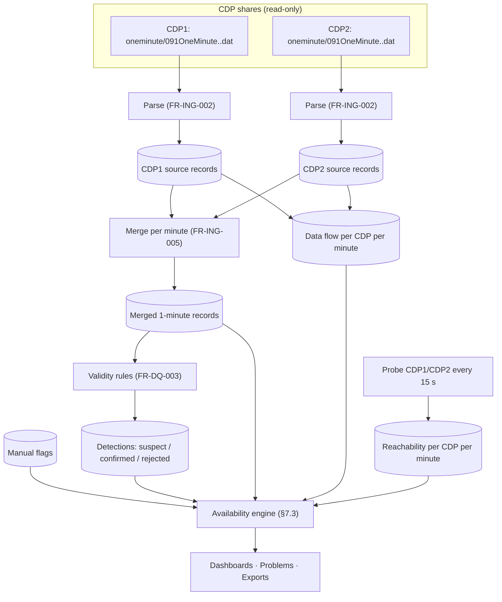
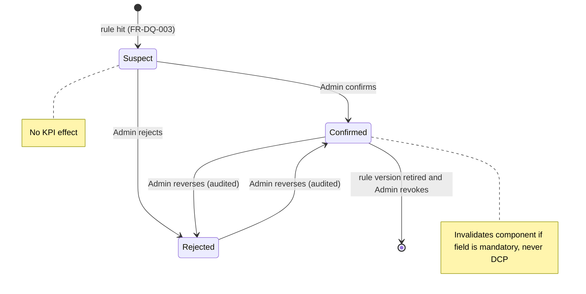
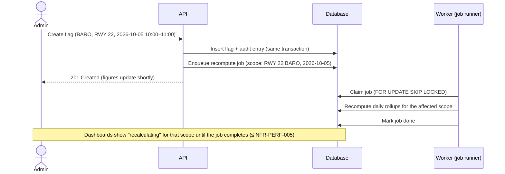
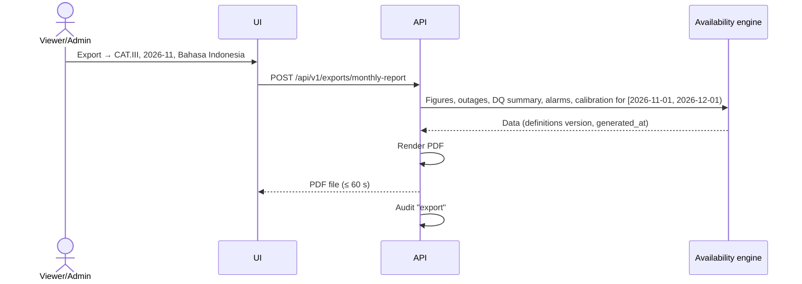
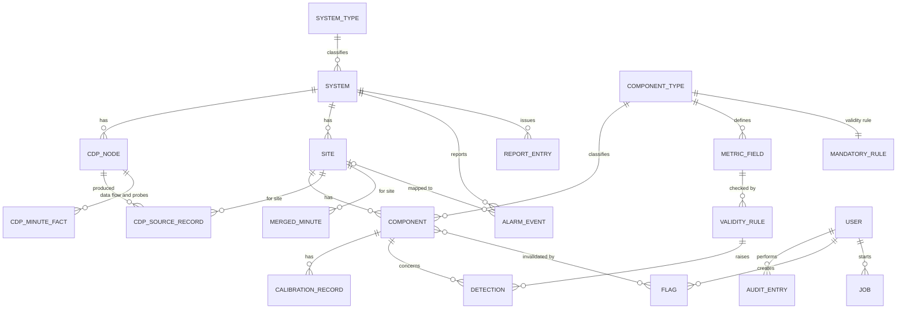
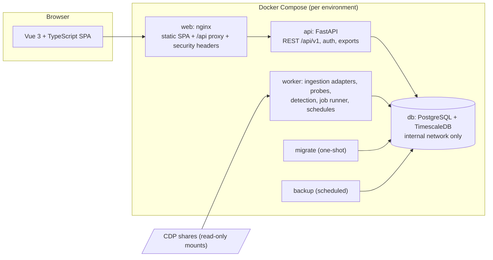
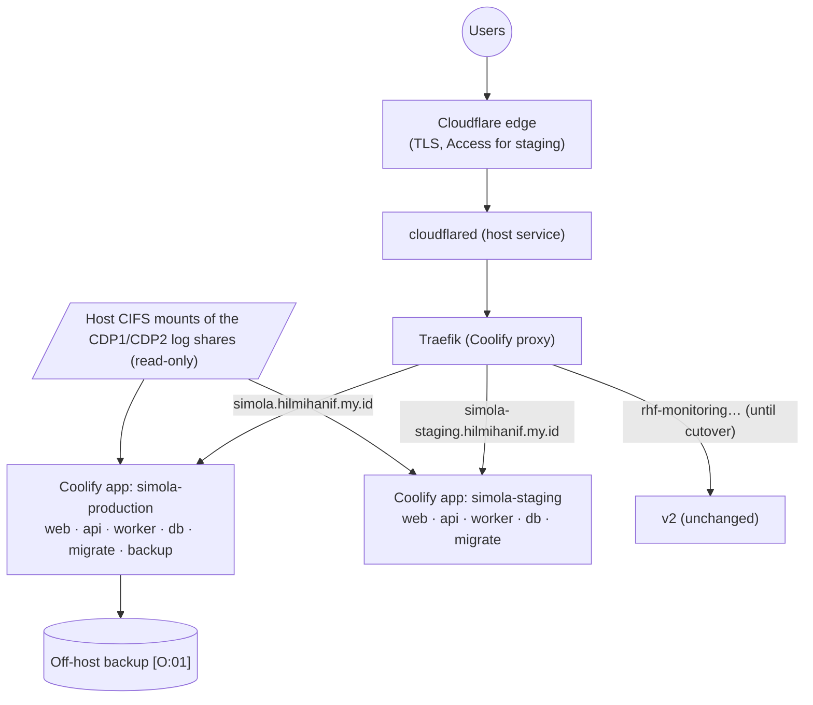

# Product Requirements Document — Sistem Monitoring ALOPTAMA (SIMOLA)

## 1. Document Control

| Field | Value |
|---|---|
| **Document title** | Product Requirements Document — Sistem Monitoring ALOPTAMA (SIMOLA) |
| **Product name** | SIMOLA (Sistem Monitoring ALOPTAMA) |
| **Version** | 1.2 |
| **Status** | **Approved** by the Product Owner on 2026-11-04 (v1.0). R1 implementation authorized 2026-11-04. v1.1 is a wording-only redaction for the public repository; v1.2 records the dashboard approved on 2026-11-09 (FR-DSH-001) |
| **Date** | 2026-11-09 |
| **Product Owner** | Station technician who owns and operates the platform (sole operator) |
| **Supersedes** | `monitoring-aloptama-v2/PRD.md` v2.1 (legacy; kept unchanged for reference) |
| **Related documents** | `ASSESSMENT.md` (existing-system assessment; private, not in the public repository) · [`QUESTIONS.md`](QUESTIONS.md) (Stage 3 decisions) |

### 1.1 Revision history

| Version | Date | Author | Change |
|---|---|---|---|
| 0.1 | 2026-11-04 | Claude (drafted with the Product Owner) | First draft, built from the assessment of v2 and the Stage 3 decisions |
| 0.2 | 2026-11-04 | Claude (with the Product Owner) | Resolved 15 of 18 open items at PRD review. Main changes: cutover moved to after R1; alarm viewer limited to logged-in users; component in-service periods became Must; legacy reachability import added to R1; public repository rules (NFR-SEC-010); targets confirmed; staging hostname; Tambelan is the first post-MVP system; free/existing services only |
| 1.0 | 2026-11-04 | Product Owner | **Approved.** v0.2 content accepted as the requirements baseline; no content changes. All [P] items approved as written (§1.2). Later changes go through a revision with a new version number |
| 1.1 | 2026-11-04 | Claude (requested by the Product Owner) | Public-release redaction (NFR-SEC-010): details of open weaknesses in the legacy system and host mount paths replaced by references to the private assessment. **No requirement changes** |
| 1.2 | 2026-11-09 | Claude (approved by the Product Owner) | FR-DSH-001: the overview's content as approved from screenshots on 2026-11-09 (a panel per system and cards across systems). No other requirement changes |

### 1.2 How to read this document

Every requirement and design statement carries a provenance tag. **This document was approved as v1.0 on 2026-11-04. With that approval, every [P] item is approved as written**; the tag stays only to show where the item came from. [O:nn] items remain open until resolved in a later revision.

| Tag | Meaning |
|---|---|
| **[D:xx]** | **Decided** by the Product Owner in Stage 3. `xx` is the decision ID in `QUESTIONS.md` (e.g. `[D:B2]`). |
| **[P]** | **Proposed** in this draft. A design or target I recommend that has not been explicitly decided. Each one is approved, changed or rejected during review. |
| **[O:nn]** | **Open**. Unresolved; listed in §18.2 as `OPEN-nn`. |
| **[V]** | **Verified fact** about the existing system or environment (source: `ASSESSMENT.md`). |
| **[I]** | **Inferred**: well-evidenced, but needs confirmation. |

Requirement keywords: **shall** = mandatory for the stated priority; **should** = recommended; **may** = optional.
Priorities use MoSCoW: **Must**, **Should**, **Could**, **Won't (now)**.
Release tags (**R1**, **R2**, **R3**) refer to the proposed internal MVP releases in §17 [P].

---

## 2. Executive Summary

### 2.1 Product overview

SIMOLA is a self-hosted web platform for monitoring the ALOPTAMA weather observing systems that the station maintains. The first system is the **AWOS CAT.III at Raja Haji Fisabilillah Airport (ICAO `WIDN`), Tanjungpinang**:
- two redundant CDP (central data processing) nodes;
- three runway sites (RWY 04, Middle, RWY 22);
- 21 monitored components.

SIMOLA measures:
- whether the AWOS is producing data;
- whether every sensor component delivers valid data;
- whether that data is plausible.

It also shows the instrument's own alarms and the meteorological reports it issues. The platform is designed to grow to include the CAT.I AWOS at Tambelan, AWS Digi, AWS Lagoi and Pekan Arba, and the ARG rain-gauge network **[D:A2]**.

### 2.2 Problem statement

The predecessor, *Monitoring Aloptama V2*, proved that the approach works, but its outputs cannot be trusted or safely operated **[V]**:
- **Headline figures are unreliable:**
  - CDP uptime was double-counted for three months.
  - Live sampling under-counts by up to about 0.7 % a day.
  - Historical CDP uptime was copied from one file to both nodes.
  - The history chart always shows 100 % OLA.
- **Data is lost:** the last minute of every day is dropped, and the redundant CDP's data is ignored.
- **Operational and security gaps** in the current production deployment. Details stay in the private assessment until the legacy system is fixed or retired.
- **Key operational needs are missing:** data-quality control, alarm visibility, report viewing, asset and calibration records, access control, and monthly reporting.

### 2.3 Proposed solution

A rebuild on the **same, proven technology stack** **[D:G1]**: PostgreSQL + TimescaleDB, Python/FastAPI, and Vue 3 (TypeScript **[D:G2]**). It runs on Docker Compose under Coolify behind a Cloudflare Tunnel, in a **new repository** that deliberately reuses v2's proven parts **[D:A4]**. SIMOLA:
1. **Defines** every availability figure as an explicit, minute-level business rule. It computes all figures through **one engine** used by every screen and report.
2. **Ingests both CDPs**, merges them per minute, and re-scans recent files, so data is not lost **[D:B5]**.
3. **Measures** CDP service by *data flow* (did the CDP produce AWOS data?). Network reachability is recorded alongside **[D:B2]** **[D:B3]**.
4. Adds **data-quality control**: automatic plausibility rules that raise *suspect* intervals for an Admin to confirm, plus manual flags. The DCP component is exempt **[D:A3]** **[D:B11]** **[D:B12]**.
5. Adds an **AWOS alarm viewer**, a **METAR/METREPORT/TAF viewer**, an **asset and calibration registry**, and **monthly PDF / CSV exports** **[D:A1]** **[D:D2]** **[D:E3]**.
6. Keeps dashboards **public with infrastructure details hidden**. Administration is behind **local accounts** with **Viewer / Admin** roles **[D:C2]** **[D:C3]** **[D:C4]**.
7. Is **operable by one person**: automated backups, CI-gated deploys, a staging environment and documented procedures **[D:F3]** **[D:F5]**.

### 2.4 Product vision

> *One trustworthy place where the station can see, explain and report the health of every ALOPTAMA system it maintains, minute by minute, with figures anyone can reproduce from the source data.*

---

## 3. Product Context

### 3.1 Business background

The station maintains automated meteorological systems ("ALOPTAMA") that serve aviation and public weather services:
- **AWOS CAT.III WIDN:**
  - Each runway site has a DCP (data collection platform) that collects sensor data.
  - Two Windows-based CDP nodes in active/passive redundancy process it.
  - Each CDP writes daily log files (1-minute observations, alarms, issued reports) to an SMB share **[V]**.
- **Other systems** the station is responsible for **[D:A2]**:
  - AWOS CAT.I at Tambelan: one CDP, one site, on a remote island.
  - AWS Digi in the meteorological garden.
  - AWS Lagoi and AWS Pekan Arba (Campbell CR6 loggers).
  - ARG rain gauges: Tembeling, Setokok, and legacy units at Tanjung Balai Karimun, Bintan Timur and Singkep.

There is **no official external definition** of the SLA/OLA figures **[D:B1]**. This PRD's definitions (§7.3) therefore become the station's authoritative rules once approved.

### 3.2 Existing system overview

| Generation | Period | Technology | Status |
|---|---|---|---|
| v1 | 2025 | Python Prometheus exporters + Grafana. Covered AWOS (web UI scraping), AWS Digi (HTTP/WebSocket), AWS and ARG (BMKG MQTT) | Retired [V] |
| Test | 2026 | InfluxDB 3 + Grafana prototype for CAT.III | Abandoned [V] |
| v2 | Aug 2026 – present | FastAPI + Vue 3 + TimescaleDB on Coolify; CAT.III only; public at `rhf-monitoring.hilmihanif.my.id` | In production [V] |

See `ASSESSMENT.md` §3–§6 for v2's architecture, data model and features.

### 3.3 Problems and limitations of the existing application

| # | Problem | Reference |
|---|---|---|
| L1 | SLA/CDP uptime inflated (Aug–Oct) or deflated (live sampling). Jan–Jul history fabricated for CDP2 | ASSESSMENT D-01–D-04 |
| L2 | Data loss: day-rollover minute dropped; redundant CDP ignored; late minutes never ingested | D-05–D-07 |
| L3 | Inconsistent figures between screens; wrong history chart; inclusive period end | D-09–D-11 |
| L4 | Access-control and exposure gaps (details in the private assessment) | ASSESSMENT §2 |
| L5 | Resilience gaps, including backups (details in the private assessment) | ASSESSMENT §2 |
| L6 | No data-quality judgement beyond "value present" | Legacy PRD §4.6 (unbuilt) |
| L7 | Alarms, reports, metadata and calibration not available | Legacy PRD §4.8–4.11 (unbuilt) |
| L8 | Telemetry deleted after 2 years, while the UI offers 5-year views | D-12 |
| L9 | No CI gate, no staging, minimal tests on business logic; single operator | ASSESSMENT §3, §4 |
| L10 | Partial responsiveness and an English-only UI | ASSESSMENT §7 (UI) |

### 3.4 Business objectives

| ID | Objective |
|---|---|
| **BO-1** | **Trustworthy figures.** Availability figures are correct, explainable down to the minute, and reproducible from the CDP source files. |
| **BO-2** | **Faster fault detection and diagnosis.** Technicians see what is wrong (CDP, DCP, sensor, data quality, instrument alarm) without opening the CDP machines. |
| **BO-3** | **One platform for all ALOPTAMA systems.** New systems are added by configuration and an ingestion adapter, without redesign. |
| **BO-4** | **Secure and recoverable operation.** No unauthenticated changes, no exposed infrastructure, and tested recovery from loss. |
| **BO-5** | **Low effort for a single operator.** Routine work (monthly reporting, recovery, deployment) is automated or one action. |

### 3.5 Expected outcomes

- Monthly SLA/OLA can be reported from SIMOLA without manual correction, and each figure can be traced to its minutes.
- Instrument faults, communication losses and implausible data are visible on one screen within minutes.
- The station keeps its full observation history (from 2025-12-24 onward) indefinitely, with a tested off-host backup.
- v2 is retired after a parallel run confirms SIMOLA's figures.

---

## 4. Goals and Success Metrics

### 4.1 Business goals

| ID | Goal | Objective |
|---|---|---|
| BG-1 | Report monthly AWOS availability from SIMOLA as the official station figure | BO-1, BO-5 |
| BG-2 | Shorten the time from an AWOS fault to a technician noticing it | BO-2 |
| BG-3 | Eliminate unauthenticated modification of data and configuration | BO-4 |
| BG-4 | Prepare the platform to onboard the remaining systems in [D:A2] | BO-3 |

### 4.2 Product goals

| ID | Goal | Objective |
|---|---|---|
| PG-1 | One availability engine with documented, minute-level definitions | BO-1 |
| PG-2 | Lossless ingestion from both CDPs, re-processable from source files | BO-1 |
| PG-3 | Data-quality workflow: suspect, then confirm or reject, plus manual flags, with an audit trail | BO-1, BO-2 |
| PG-4 | Status, alarm and problem views that point straight to the faulty component | BO-2 |
| PG-5 | Role-based access, hardened deployment, automated backups | BO-4 |
| PG-6 | One-click monthly PDF report and CSV exports | BO-5 |
| PG-7 | Registry-driven model for systems, sites and components | BO-3 |

### 4.3 Measurable success criteria

Targets marked [D:OPEN-14] were confirmed at PRD review. Any remaining [P] target is approved together with the PRD.

| ID | Criterion | Target | Measured by | Goal |
|---|---|---|---|---|
| SM-1 | KPI correctness | 100 % agreement (exact minute counts) between SIMOLA and an independent recount from source files, for at least 3 reference months | Verification script (§15.6) | PG-1 |
| SM-2 | Ingestion completeness | For every completed UTC day, stored minutes = union of minutes present in either CDP file | Daily reconciliation check | PG-2 |
| SM-3 | Data freshness | A minute written to a CDP file is visible on the dashboard within **3 min** (p95) [D:OPEN-14] | Ingestion-lag metric | PG-4 |
| SM-4 | Fault visibility | A CDP that stops producing data, or a component with missing mandatory fields, appears in the Problems panel within **5 min** [D:OPEN-14] | Staging fault-injection test | PG-4 |
| SM-5 | Recoverability | Nightly backup success ≥ 99 % per quarter; full restore drill passes each quarter; RPO ≤ 24 h, RTO ≤ 4 h [D:OPEN-14] | Backup logs, restore drill record | PG-5 |
| SM-6 | Security | 0 state-changing endpoints reachable without Admin authentication; 0 infrastructure details in anonymous responses; DB not network-published | Automated security tests (§15.4) | PG-5 |
| SM-7 | Reporting effort | Monthly PDF report generated in ≤ 1 action and ≤ 60 s [P] | Manual check at UAT | PG-6 |
| SM-8 | Extensibility | A new site or component of an existing system type is added by configuration only (no code change) | Acceptance test | PG-7 |

### 4.4 Key performance indicators (product KPIs)

These are the figures SIMOLA **computes and displays**. Their formal definitions are in §7.3. There are **no official targets** **[D:B7]**. Colour thresholds are display settings only.

| KPI | Short definition | Decision |
|---|---|---|
| **SLA — System availability** | % of minutes in which **at least one CDP produced AWOS data** | [D:B2] [D:B3] |
| **Per-node uptime** | % of minutes in which a given CDP produced AWOS data | [D:B3] |
| **Network reachability** (informational) | % of probed minutes in which a CDP answered a network probe | [D:B2] |
| **Component availability** | % of minutes in which all *mandatory* fields of a component were valid and not invalidated by a confirmed flag or detection | [D:B4] [D:B4a] [D:B11] |
| **Site availability** | Pooled component availability over a site's components (including DCP) | Retained from v2 [P] |
| **OLA** | Mean of the site availabilities of a system | Retained from v2 [P] |
| **Pooled component availability** ("OLA-21") | Valid component-minutes ÷ expected component-minutes over all sites | Retained from v2 [P] |

### 4.5 Traceability overview

| Objective | Product goals | Requirement groups | Verification |
|---|---|---|---|
| BO-1 | PG-1, PG-2, PG-3 | FR-KPI, FR-ING, FR-DQ, FR-DSH-009 | SM-1, SM-2, §15.6 |
| BO-2 | PG-3, PG-4 | FR-DSH, FR-ALM, FR-DQ | SM-3, SM-4, E2E journeys J2/J3 |
| BO-3 | PG-7 | FR-REG, FR-ING-012 | SM-8 |
| BO-4 | PG-5 | FR-AUTH, FR-AUD, NFR-SEC, NFR-BAK | SM-5, SM-6 |
| BO-5 | PG-6 | FR-EXP, FR-ADM, NFR-OPS | SM-5, SM-7 |

Each functional requirement in §7 lists the objectives it traces to.

---

## 5. Stakeholders and User Personas

### 5.1 Stakeholder groups

| Stakeholder | Interest | Source |
|---|---|---|
| **Product Owner / Operator** (station technician) | Owns requirements; builds, deploys and operates SIMOLA alone | [D:F5] |
| **Station technicians** | Diagnose faults, judge data quality, maintain asset records, produce reports | [D:C1] |
| **Station head** | Reads availability summaries and monthly reports | [D:C1] |
| **Anonymous public** | May view public dashboards (C2). Not a confirmed user group; no requirements are derived from their needs beyond read access | [D:C2] |

The following were **not** confirmed as users and are therefore **not** design targets: observers/forecasters as a distinct group, BMKG regional/HQ staff, and the AWOS vendor. They can still use the public dashboards.

### 5.2 User types and responsibilities

| User type | Role in SIMOLA | Responsibilities | Status |
|---|---|---|---|
| Technician | **Admin** | Triage problems; review suspect detections; flag bad data; maintain registry, metadata and calibration; run reprocess jobs; manage users; export reports | [D:OPEN-03] |
| Station head | **Viewer** | Read dashboards, alarms and infrastructure details; download monthly reports and CSV exports | [D:OPEN-03] |
| Public | *(anonymous)* | Read public dashboards and reports. No alarm viewer | [D:C2] [D:OPEN-13] |

Expected user count: fewer than 10 accounts [D:OPEN-03].

### 5.3 User needs

| ID | Need | User |
|---|---|---|
| UN-1 | See at a glance whether the AWOS is producing data and which component is failing | Technician, Station head |
| UN-2 | Understand *why* a figure is below 100 % (which minutes, which component, which cause) | Technician, Station head |
| UN-3 | Mark data that is present but wrong, so availability reflects reality | Technician |
| UN-4 | Know when sensors are due for calibration | Technician |
| UN-5 | Get a monthly report without assembling it by hand | Technician, Station head |
| UN-6 | See what the AWOS itself reported (alarms) and issued (METAR, METREPORT, TAF) | Technician |
| UN-7 | Use the system in Indonesian or English | All [D:C5] |
| UN-8 | Trust that nobody outside the team can change data or configuration | Product Owner |

### 5.4 Roles and permissions

Decided roles: **Viewer** and **Admin** **[D:C3]**, plus the anonymous public **[D:C2]**. The permission matrix below applies those decisions. Rows marked [P] are my detailing and need confirmation.

| Capability | Public | Viewer | Admin |
|---|:-:|:-:|:-:|
| View dashboards, KPIs, charts, status, Problems panel | ✓ | ✓ | ✓ |
| View confirmed flags and confirmed detections as chart overlays [P] | ✓ | ✓ | ✓ |
| See the number of active AWOS alarms (Problems panel) | ✓ | ✓ | ✓ |
| View AWOS alarm list and history (time, name, type, state, site/component) [D:OPEN-13] | – | ✓ | ✓ |
| View AWOS alarm **message text** [D:OPEN-13] | – | ✓ | ✓ |
| View infrastructure details (IP addresses, share paths, health internals, ingestion diagnostics) | – | ✓ | ✓ |
| View METAR / METREPORT / TAF | ✓ | ✓ | ✓ |
| View asset metadata: names, types, calibration status [P] | ✓ | ✓ | ✓ |
| View serial and part numbers [D:OPEN-13] | – | ✓ | ✓ |
| View suspect detections (unconfirmed) [D:OPEN-13] | – | ✓ | ✓ |
| Export monthly PDF and CSV | – | ✓ | ✓ |
| Confirm/reject detections; create/remove manual flags | – | – | ✓ |
| Edit validity rules, mandatory fields, thresholds, settings | – | – | ✓ |
| Edit registry, metadata, calibration records | – | – | ✓ |
| Start reprocess / recompute jobs | – | – | ✓ |
| Manage user accounts | – | – | ✓ |
| View audit log [P] | – | – | ✓ |

---

## 6. Scope

### 6.1 In scope (overall product)

- Monitoring of the AWOS CAT.III WIDN (MVP), then the systems in [D:A2].
- Minute-level availability measurement, data-quality control, alarm and report viewing, asset and calibration registry, exports, access control, administration, bilingual UI.
- Deployment, backup, staging and transition from v2.

### 6.2 MVP scope

The MVP is **AWOS CAT.III WIDN** with everything below **[D:A1]** **[D:A3]**:

| Area | MVP content | Decisions |
|---|---|---|
| Ingestion | Both CDPs; per-minute merge; re-scan; network probes; alarm and report files; historical load from 2025-12-24 | B5, B8, B2 |
| KPIs | SLA (system availability), per-node uptime, reachability, component/site availability, OLA; UTC periods | B2–B6 |
| Data quality | Validity rules (range, stuck, spike), suspect → confirm/reject, manual flags, DCP exempt | A3, B11, B12 |
| Registry | Systems, sites, CDPs, components, mandatory fields, station/site/sensor metadata, calibration | A3, B4a |
| Dashboards | Overview, system dashboard, site pages, Problems panel (on-screen alerts only) | D1 |
| Alarms | AWOS ALARM viewer, display only | D2 |
| Reports | METAR (incl. SPECI) / METREPORT / TAF raw viewer and archive | A1 |
| Exports | Monthly PDF report; CSV exports | E3 |
| Access | Public dashboards with hidden details; local accounts; Viewer / Admin | C2–C4 |
| Platform | Bilingual ID/EN UI; audit log; staging; CI; backups; parallel run and cutover | C5, F3, G5 |

### 6.3 Out of scope for the MVP (planned later)

| Item | Planned phase | Decision |
|---|---|---|
| AWOS CAT.I Tambelan | Post-MVP | [D:A2] [D:F4b] |
| AWS Digi, AWS Lagoi / Pekan Arba, ARG rain gauges | Post-MVP | [D:A2]; data source [O:02] |
| Push notifications (Telegram, email, etc.) | Later phase | [D:D1] |
| Maintenance/incident log and "adjusted" KPIs | Later phase | [D:B10] |
| Acknowledging AWOS alarms inside SIMOLA | Not planned | [D:D2] |

### 6.4 Out of scope (Won't, now)

- SYNOP and ATIS viewing (files exist; not selected) [D:A3].
- Parsing reports into structured fields or charts (raw viewer only) — carried over from the legacy PRD [P].
- Self-registration, single sign-on, external identity providers [D:C4].
- Multi-host or high-availability deployment, Kubernetes, microservices [D:F1] [D:G1].
- Writing to, controlling or configuring any AWOS/CDP equipment. SIMOLA is strictly read-only towards instruments [P].
- Light theme (Could; see UX-004).

### 6.5 Potential future enhancements

Notification channels with escalation; maintenance-window exclusions; SYNOP/ATIS viewer; structured METAR decoding and trends; alarm-to-outage correlation; a public status page; mobile-friendly PWA; an external API for other BMKG systems.

---

## 7. Functional Requirements

### 7.1 Module overview

| Module | Prefix | Purpose | MVP release [P] |
|---|---|---|---|
| Registry and assets | FR-REG | Systems, sites, CDPs, components, fields, metadata, calibration | R1 / R2 |
| Availability engine | FR-KPI | Formal KPI definitions and their computation | R1 / R2 |
| Ingestion | FR-ING | Reading, parsing, merging and health of all data sources | R1 / R3 |
| Data quality | FR-DQ | Validity rules, suspect review, manual flags | R2 |
| Dashboards | FR-DSH | Overview, system dashboard, site pages, Problems panel | R1 / R2 |
| Alarms | FR-ALM | AWOS ALARM viewer | R3 |
| Reports | FR-RPT | METAR/SPECI, METREPORT, TAF viewer | R3 |
| Exports | FR-EXP | Monthly PDF report, CSV exports | R3 |
| Access | FR-AUTH | Accounts, sessions, roles, public response shaping | R1 / R2 |
| Administration | FR-ADM | Admin area, jobs, settings, system health | R1 / R2 |
| Audit | FR-AUD | Append-only audit trail | R2 |
| Localization | FR-L10N | Indonesian / English | R1 / R3 |

Requirement format: **ID · Title** — `Priority · Release · Traces · Source`, then description and numbered acceptance criteria (AC).

---

### 7.2 Registry and assets (FR-REG)

**FR-REG-001 · Registry-driven model** — `Must · R1 · BO-3 · [D:G4]`
The system shall keep a registry of system types, systems, sites, CDP nodes, components and metric fields. Ingestion, the availability engine and the UI shall take their lists of sites, components and fields from the registry, not from hard-coded lists in business logic.
1. The registry is seeded for AWOS CAT.III WIDN: 1 system, 2 CDP nodes, 3 sites, 21 components (7 per site including DCP), as listed in §9.2.
2. Adding a component of an existing type to an existing site makes it appear in dashboards and KPIs without a code change (SM-8).
3. Every registry entity has a stable code, and a display name in Indonesian and English.

**FR-REG-002 · Metric field definitions and source mapping** — `Must · R1 · BO-1 · [V]`
Each metric field shall define: code, display name (ID/EN), unit, type (numeric or text), scale factor, the component it belongs to, and the fixed-width source slice for each site. Source mappings live in version-controlled configuration and are not editable in the UI [P].
1. All 20 CAT.III fields reproduce the slices proven in production by v2 (`monitoring-aloptama-v2/backend/app/ingestion/parsers.py`, `_SLICES`) [V].
2. Golden-file tests with real CDP files pass for every field (§15.1).

**FR-REG-003 · Mandatory fields per component** — `Must · R2 · BO-1 · [D:B4] [D:B4a]`
Each component shall have a set of mandatory fields that decides minute validity (§7.3). Defaults:

| Component | Mandatory | Optional |
|---|---|---|
| ATRH | TEMP, RH | DEWP |
| BARO | QNH | DA |
| ANEM | WS, WD | WGS, WGD |
| RVR (RVR+ALS at RWY 04) | RVR | VIS, ALS, D/N, RLS |
| CEL | LR1 | SKY |
| PWX (Present Weather) | PW | RA |
| RAIN | RA | — |
| SOLR | SOL | — |
| LIGH | LTX | — |
| DCP | *(special rule, §7.3)* | — |

1. The defaults above are seeded.
2. An Admin can change a component type's mandatory fields. Each change is audited with before/after values (FR-AUD-001).
3. A change applies to **all periods**, past and future, and triggers recomputation (FR-KPI-008) [D:OPEN-12]. The audit entry records when the rule changed.
4. At least one mandatory field is always required. The DCP rule is not editable.

**FR-REG-004 · Station, site and component metadata** — `Must · R2 · BO-2 · [D:A3]`
Admins shall maintain metadata at three levels. Fields carried over from the legacy PRD are marked (L); the others are [P].

| Level | Fields |
|---|---|
| Station / system | Name (L), ICAO code (L), WMO station number (L), airport name (L), coordinates (lat/lon/elevation) (L), procurement year (L), notes |
| Site | Name, code, coordinates (L), elevation / threshold elevation (L), description |
| Component (sensor) | Sensor type (L), manufacturer, model, part number (L), serial number (L), installation date (L: year), firmware/version, notes |

1. Admin can create and edit all fields. Every change is audited.
2. Validation: latitude −90..90, longitude −180..180, dates not in the future, ICAO code 4 letters.
3. Public and Viewer visibility follows §5.4. Serial and part numbers are hidden from the public.

**FR-REG-005 · Calibration records and status** — `Must · R2 · BO-2 · [D:A3]`
Each component shall have a calibration history: date, performed by, reference/certificate number, next due date (or interval), and notes. Calibration status is derived: **OK**, **Due soon** (≤ 30 days to due, configurable [P]), **Overdue**, **Unknown** (no record).
1. Status is shown on site pages and in the registry list. The list can be filtered by status.
2. Overdue components appear in the Problems panel (FR-DSH-010).
3. Status uses UTC dates.

**FR-REG-006 · Component in-service periods** — `Must · R2 · BO-1 · [D:OPEN-17]`
An Admin may set an in-service start and end for a component, for example when a sensor is removed, not yet installed, or being replaced. Minutes outside that window are excluded from its expected minutes, and its status shows "not in service".
1. A component decommissioned on day D has no expected minutes after D, and site availability excludes it from D onward.

**FR-REG-007 · Data coverage start** — `Must · R1 · BO-1 · [P]`
Each system shall have a data coverage start. Minutes before it are excluded from expected minutes, and the UI shows "no data coverage" instead of a percentage. For CAT.III WIDN it is the first record in the earliest available CDP file (2025-12-24) [V].
1. A period entirely before coverage start shows "—" with a "no coverage" note, never 0 % or 100 %.

---

### 7.3 Availability definitions and engine (FR-KPI)

#### 7.3.1 Formal definitions

All times are UTC, at **minute resolution**. A minute `m` stands for the interval `[m, m + 60 s)`.

| Symbol | Definition | Decision |
|---|---|---|
| `P = [t₀, t₁)` | Reporting period: **start-inclusive, end-exclusive**, UTC boundaries | [D:B6] |
| `G` | Freshness grace, default **3 minutes**, Admin-configurable | [P] |
| `M(P)` | Evaluated minutes: `t₀ ≤ m < min(t₁, now − G)`, and `m ≥ coverage_start`, and the component is in service | [P] |
| `N` | `|M(P)|`: expected minutes | — |
| `DF(c, m)` | **Data flow.** 1 if CDP `c`'s 1-minute file contains a parseable record for minute `m`, else 0. A record whose fields are all missing still counts as data flow (0–3 such minutes per month observed [V]) | [D:B2] [D:OPEN-06] |
| `PING(c, m)` | **Reachability.** 1 if ≥ 1 probe of `c` succeeded during `m`; 0 if probes ran and all failed; *no sample* if no probe ran | [D:B2] |
| `REC(s, m)` | **Merged record** for site `s` and minute `m`, built from whichever CDP records exist (FR-ING-005) | [D:B5] |
| `V(f, s, m)` | **Field valid.** `REC(s, m)` exists and field `f` is not *missing* (FR-ING-002) | [V] contract |
| `INV(k, s, m)` | **Invalidated.** Minute `m` of component `k` at site `s` is covered by a **confirmed** detection on a mandatory field, or by a manual flag | [D:B11] |
| `CV(k, s, m)` | **Component valid** = `REC(s, m)` exists ∧ every mandatory field `f` of `k` has `V(f, s, m)` ∧ ¬`INV(k, s, m)` | [D:B4] |
| `DV(s, m)` | **DCP valid** = `REC(s, m)` exists ∧ some field of a non-DCP component at `s` is valid. Never affected by flags or detections | [D:B4a] [D:B12] |

| KPI | Formula | Decision |
|---|---|---|
| **SLA (system availability)** | `Σ_m max_c DF(c, m) / N × 100` | [D:B3] |
| **Per-node uptime** `U_c` | `Σ_m DF(c, m) / N × 100` | [D:B3] |
| **Network reachability** `R_c` | `Σ_m [PING(c, m) = 1] / Σ_m [PING(c, m) has a sample] × 100`, shown with **probe coverage** = `Σ_m [has sample] / N` | [D:B2] |
| **Component availability** `A_k(s)` | `Σ_m CV(k, s, m) / N × 100` (DCP uses `DV`) | [D:B4] |
| **Site availability** `A_s` | `Σ_k Σ_m CV(k, s, m) / (|K(s)| × N) × 100`, where `K(s)` = the site's components including DCP | v2 rule [P] |
| **OLA** | Arithmetic mean of `A_s` over the system's sites | v2 rule [P] |
| **Pooled component availability** | `Σ_s Σ_k Σ_m CV / Σ_s |K(s)| × N × 100` | v2 rule [P] |

#### 7.3.2 Requirements

**FR-KPI-001 · Single availability engine** — `Must · R1 · BO-1 · [V] D-11`
Every figure on dashboards, history charts, site pages, PDF and CSV exports, and API responses shall come from one engine that implements §7.3.1.
1. An automated test computes one period through every surface (system dashboard, site page, history, PDF data, CSV) and finds identical values.

**FR-KPI-002 · Periods** — `Must · R1 · BO-1 · [D:B6]`
Supported periods: UTC day, ISO week (Monday–Sunday) [P], calendar month, quarter, year, and a custom range with minute precision. The current period is shown "so far".
1. September 2026 has exactly 43,200 expected minutes, and no minute belongs to two adjacent months (fixes D-09).
2. A custom range with start ≥ end is rejected with a validation message.

**FR-KPI-003 · Expected minutes and grace** — `Must · R1 · BO-1 · [P]`
For periods that include the present, evaluation shall stop at `now − G`. Every figure for an open period shows its "as of" time.
1. At 10:30:00 UTC with G = 3, today's expected minutes are 627 (00:00–10:26).
2. Changing G (Admin setting) is audited and affects only open periods.

**FR-KPI-004 · SLA (system availability)** — `Must · R1 · BO-1 · [D:B2] [D:B3]`
SLA shall be computed per §7.3.1. A minute counts as up when **at least one** CDP produced data.
1. Fixture: CDP1 lacks minutes {a, b, c}, CDP2 lacks {c, d}. SLA counts only `c` as down; CDP1 uptime has N−3 up minutes and CDP2 has N−2.
2. Network probe results never change SLA.

**FR-KPI-005 · Per-node uptime and reachability** — `Must · R1 · BO-1, BO-2 · [D:B2] [D:B3]`
Per-node uptime and network reachability shall be computed and shown separately. Reachability is labelled informational and always shown with its probe coverage.
1. A day with probes in every minute and no failures shows 100.00 % reachability (fixes D-02).
2. Periods with no probe data show reachability "not measured". Periods covered by imported v2 samples are labelled "legacy (v2)" (FR-ING-014).

**FR-KPI-006 · Component, DCP, site, OLA and pooled availability** — `Must · R1 (flags/detections: R2) · BO-1 · [D:B4] [D:B11] [D:B12]`
Computed per §7.3.1.
1. A minute with TEMP valid and RH missing makes ATRH invalid (default mandatory fields).
2. A confirmed flag on BARO from 10:00 to 11:00 makes BARO invalid for 60 minutes, and DCP is unaffected.
3. An unconfirmed (suspect) detection has no effect on any figure.
4. A minute whose merged record exists but has every field missing counts as SLA up and DCP invalid.

**FR-KPI-007 · Precision, rounding, no capping** — `Must · R1 · BO-1 · [P]`
Calculations shall use integer minute counts. Percentages are displayed to 2 decimals (round half up). Raw counts (valid, expected, missing) are available everywhere a percentage is shown. Results above 100 % are impossible by construction; the engine asserts this and a test covers it (no capping, unlike v2). When `N = 0` the figure shows "—".
1. Property-based tests over random fixtures never produce values outside 0–100 %.
2. Every KPI tooltip or detail shows "valid / expected minutes".

**FR-KPI-008 · Live recalculation with traceability** — `Must · R2 · BO-1 · [D:B9]`
When underlying data or rules change, every affected period shall reflect the change within the target in NFR-PERF-005. Such changes include: reprocessing, a flag added/edited/removed, a detection confirmed or rejected, a mandatory-field change, or a validity rule change. Each change is recorded in the audit log with its cause and scope.
1. After an Admin flags 60 minutes of last month, that month's component, site and OLA figures change within the target, and the audit log shows the flag as the cause.
2. Exported reports carry "generated at (UTC)" and the definitions version.

**FR-KPI-009 · Outage breakdown** — `Should · R1 · BO-1, BO-2 · [P]`
For any scope (system, CDP, site, component) and period, the engine shall list contiguous invalid intervals with start, end, duration and cause:
- no record;
- mandatory field missing;
- flagged;
- confirmed detection;
- CDP not producing data.
1. Interval durations for a period add up exactly to its missing minutes.

**FR-KPI-010 · Definitions page** — `Should · R3 · BO-1 · [P]`
A public page shall explain each KPI in Indonesian and English, including current mandatory fields and the definitions version.

---

### 7.4 Ingestion (FR-ING)

**FR-ING-001 · Read both CDPs independently (read-only)** — `Must · R1 · BO-1 · [D:B5]`
In each cycle (≤ 60 s), the worker shall read the current-day 1-minute file from **each** CDP share independently. A failure on one CDP shall not delay or block the other. Shares are mounted read-only (NFR-SEC-006).
1. With CDP1's share unavailable, CDP2's data is still ingested, and CDP1 shows "source unavailable" in the Problems panel.
2. The ingestion process has no write access to the shares (verified in deployment tests).

**FR-ING-002 · Parsing contract** — `Must · R1 · BO-1 · [V] [P]`
The WIDN 1-minute parser shall:
- skip the 4 header lines;
- read the timestamp from the fixed date/hour/minute columns as **UTC**;
- extract fields using the slices in FR-REG-002 and apply scale factors.

Token rules:
- A run of `/` characters means **missing** [V].
- `M`, `MM`, `N/A`, `---` also mean **missing** [P]. These were never observed in 10 months of data [V].
- Empty or whitespace means **present and healthy** (numeric 0, text empty) [V].
- An unparseable numeric value is **missing** and counted as a parse warning.
- The gust rule is kept [V]: if WS/WD is missing, gust is missing; otherwise a missing gust becomes 0.

Lines with an unparseable timestamp are skipped and counted.
1. Golden-file tests with at least 3 real daily files pass (including the 2026-11-03 files with gaps).
2. For every rule kept from v2, the output is identical to v2's parser on the same files.

**FR-ING-003 · Per-CDP source records** — `Must · R1 · BO-1 · [D:B5] [D:B8]`
Parsed records shall be stored per CDP, so that merging and data flow can be recomputed at any time without re-reading files.
1. Rebuilding the merged table from stored per-CDP records gives the same result as fresh ingestion.

**FR-ING-004 · Data-flow facts** — `Must · R1 · BO-1 · [D:B2]`
For every CDP and minute, the system shall record `DF(c, m)` as defined in §7.3.1, derived from the stored per-CDP records.
1. For 2026-11-03, CDP1 shows 10 minutes and CDP2 shows 7 minutes without data flow, matching the source files [V].

**FR-ING-005 · Per-minute merge** — `Must · R1 · BO-1 · [D:B5]`
For each site and minute, the merged record shall be the **preferred CDP's** record when present, otherwise the other CDP's. The preferred CDP is CDP1 [D:OPEN-07]. If the preferred record has every field missing and the other CDP's record has valid fields, the other record is used [P]. The merged record stores which CDP supplied it. When both CDPs have a record and any field differs, a disagreement counter is incremented (diagnostic only).
1. For 2026-11-03, the merged data is missing exactly 4 minutes (00:30, 10:50, 10:51, 10:52): the overlap of both CDPs' gaps [V].

**FR-ING-006 · Re-scan and day rollover** — `Must · R1 · BO-1 · [V] D-05, D-07`
Each cycle shall re-read the whole current-day file, and the previous day's file during the first 2 hours after 00:00 UTC [P]. It inserts minutes not yet stored and updates changed ones idempotently. Ingestion shall not depend on "only minutes after the latest stored minute".
1. A 23:59 record written after midnight is ingested.
2. A minute earlier than the latest stored minute that appears late is ingested.
3. Running a cycle twice in a row changes nothing.

**FR-ING-007 · Network probes** — `Must · R1 · BO-2 · [D:B2]`
The worker shall probe each CDP every 15 s [P] using an explicitly configured method. Default: TCP connect to the SMB port 445, which is the service SIMOLA depends on [P]. ICMP is optional and needs a ping binary plus the `NET_RAW` capability. (v2 claimed "ICMP first", but its image has no `ping` binary, so every v2 probe was a TCP connect to ports 80/443/22/2049 [V].)

For each CDP and minute it stores: probes attempted, probes succeeded, minimum round-trip time, method, and last error. Probes never feed SLA.
1. A healthy minute has about 4 attempts and 4 successes.
2. A worker outage leaves "no sample" minutes, which are not counted as failures.
3. The configured probe method is shown on the health page (Viewer+).

**FR-ING-008 · AWOS alarm file ingestion** — `Must · R3 · BO-2 · [D:A1] [D:D2]`
The worker shall read `alarm/091ALARM.<YYYYMMDD>.dat` from both CDPs. The file is CSV with a header row: `DD/MM/YYYY HH:MM:SS, Site Identifier, Alarm Name, Type, State, Active, Message`.
- Fields are trimmed, including trailing tabs [V].
- Timestamps are treated as **UTC** [I] [O:11].
- Identical rows from both CDPs are stored once, recording which CDPs reported them.
- Alarms are mapped to a site/component through an Admin-editable table. Seed mapping from the AWOS message text [I]: `DCPA*` → RWY 04, `DCPB*` → Middle, `DCPC*` → RWY 22.
1. Re-reading a file creates no duplicates.
2. The 2026-11-03 `DCP*_Missing` alarms (10:43 UTC) appear next to the 10:38–10:54 data gap on the timeline.

**FR-ING-009 · Report file ingestion** — `Must · R3 · BO-2 · [D:A1]`
The worker shall read, from both CDPs:
- `reports/METAR.<date>.log` (contains METAR and SPECI);
- `reports/METREPORT.<date>.log`;
- `reports/TAF.<date>.log`.

It skips header lines and stores each issued report with its log timestamp (UTC), type, raw text and source CDP(s). Duplicates across CDPs are stored once.
1. Every METAR line in a reference day's file appears exactly once.

**FR-ING-010 · Reprocess jobs** — `Must · R1 (command line) / R2 (Admin UI) · BO-1, BO-5 · [V] D-15`
An Admin shall be able to re-ingest a UTC date range for chosen sources (1-minute, alarm, report) from the CDP files.
- Jobs are persisted and run in the worker.
- They are idempotent, report progress, and can be cancelled.
- Only one reprocess job per source runs at a time.
- Each job is audited.
- Deployments and restarts never start a reprocess automatically.
1. Reprocessing a day that is already complete changes nothing.
2. Restarting the API during a job does not lose the job's state.

**FR-ING-011 · Historical load** — `Must · R1 · BO-1 · [D:B8] [D:E2]`
Before go-live, all available CDP files from 2025-12-24 onward shall be loaded through FR-ING-010. A daily reconciliation report (per-CDP minutes, merged minutes, gaps) is produced.
1. Every completed day satisfies SM-2.
2. Reachability before SIMOLA probing began shows "not measured".

**FR-ING-012 · Source adapter framework** — `Should · R1 (framework) / post-MVP (more adapters) · BO-3 · [D:A2] [P]`
Ingestion shall be structured as adapters behind one interface (discover → fetch → parse → store facts → report health), so file-share, MQTT and HTTP/WebSocket sources can be added for future systems.
1. CAT.III ingestion is implemented as an adapter.
2. A test adapter with synthetic data can be added without changing the KPI engine.

**FR-ING-013 · Ingestion health** — `Must · R1 · BO-2 · [P]`
For each source, the system shall track:
- last successful read and last record time;
- lag behind now;
- parse warnings;
- share availability.

These feed the Problems panel and the health page.
1. Unmounting a share raises "source unavailable" within 2 cycles.

**FR-ING-014 · Legacy reachability import** — `Must · R1 · BO-1 · [D:OPEN-04]`
At cutover, v2's live probe samples (2026-08-14 → cutover) shall be imported as *legacy reachability*:
- clearly labelled as measured by v2 (TCP probes, ASSESSMENT D-17);
- aggregated to minutes, with SIMOLA's probe coverage rules applied;
- never affecting SLA.

v2's backfill rows (minute-aligned, derived from file presence) are excluded, because they are not probe results (ASSESSMENT D-03).
1. Reachability for September 2026 shows a "legacy (v2)" label and its probe coverage.
2. No imported row has a minute-aligned original timestamp.

---

### 7.5 Data quality (FR-DQ)

**FR-DQ-001 · Validity rule types** — `Must · R2 · BO-1 · [D:A3]`
The system shall support these rules per metric field, scoped to a component type with optional per-site override:

| Rule | Detects | Parameters |
|---|---|---|
| **Range** | Physically implausible values | min, max |
| **Stuck** | Value unchanged for too long | minimum consecutive minutes, optional values to ignore (e.g. 0 for rainfall or night-time solar) |
| **Spike** | Implausible jump between consecutive valid minutes | maximum absolute change, optional minute window |

Starting values are **proposed from the historical data** (10+ months) and instrument norms, then reviewed by the Product Owner. Rules stay **disabled** until approved [D:OPEN-08].
1. Missing values never trigger a rule, and a missing minute breaks stuck and spike sequences.
2. Each rule type has unit tests for its boundary values.

**FR-DQ-002 · Rule management** — `Must · R2 · BO-1 · [D:A3]`
Admins shall create, edit, enable and disable rules. Rules are versioned, and every change is audited with before/after values and triggers re-evaluation (FR-DQ-003).

**FR-DQ-003 · Detection runs** — `Must · R2 · BO-1 · [P]`
Detection shall run incrementally after each ingestion cycle on new minutes. On a rule change or a reprocess, it re-runs over the affected range (default: full history [P]). Results are merged into intervals (component, field, rule, rule version, parameter snapshot, start, end).
1. The same data with the same rules always produces the same detections.

**FR-DQ-004 · Suspect review** — `Must · R2 · BO-1, BO-2 · [D:B11]`
New detections are **Suspect** and have no effect on figures. Admins review a queue (filterable by system, site, component, rule and date) with chart context. They **confirm** or **reject**, singly or in bulk, with an optional note.
- A rejected detection is not raised again for the same interval and rule version.
- An Admin can reverse a decision; this is audited.
1. Confirming a detection updates the figures (FR-KPI-008). Rejecting one leaves them unchanged.

**FR-DQ-005 · Effect of confirmed detections** — `Must · R2 · BO-1 · [D:B11] [D:B12]`
A confirmed detection on a **mandatory** field invalidates the component for its interval. A confirmed detection on an **optional** field marks the field only, with no KPI effect [P]. DCP is never affected.

**FR-DQ-006 · Manual flags** — `Must · R2 · BO-1 · [D:A3] [D:B12]`
Admins shall create flags on one or more components for a UTC time range (minute precision). Each flag has a reason category (sensor fault, maintenance, calibration, environmental, other [P]) and a note.
- Flags may overlap; the union applies [P].
- Flags are editable and removable (soft delete) and audited.
- Flags take effect through FR-KPI-008.
- DCP cannot be flagged.
1. Removing a flag restores the previous figures and leaves an audit entry.

**FR-DQ-007 · Overlays** — `Must · R2 · BO-1, BO-2 · [P]`
Confirmed flags and detections shall be drawn as shaded intervals on sensor charts and in the minute drill-down, with their reason. Suspect detections are visible to Viewers and Admins only.

**FR-DQ-008 · Data-quality summary** — `Should · R3 · BO-1, BO-5 · [P]`
For a period, show minutes and counts of confirmed detections and flags by component and reason, plus the number of pending suspects. Included in the monthly PDF.

---

### 7.6 Dashboards (FR-DSH)

**FR-DSH-001 · Overview** — `Must · R1 · BO-2, BO-3 · [P]`
The overview lists configured systems with headline status: SLA today and month-to-date, OLA month-to-date, and active problem count. It shows only configured systems, with no "coming soon" placeholders.
Since v1.2 (dashboard approved by the Product Owner on 2026-11-09), each system has a panel with its current problems, its CDPs' data flow, the last data minute, the latest METAR, the month so far day by day (each day opens the system dashboard on that day) and every site's component status. Cards under the panels cover every system: the largest outages of the last 7 days and calibration status for everyone; active AWOS alarms and last month's report for Viewers and Admins. A new system adds a panel and its share of each card.

**FR-DSH-002 · System dashboard** — `Must · R1 · BO-1, BO-2 · [D:B3]`
For the selected period, the dashboard shows SLA, per-node uptime, reachability (informational), OLA and pooled availability. Each figure can show its valid / expected / missing minutes. One period selector controls the whole page [P] (v2 had three independent pickers).
1. Displayed values equal the engine's values.
2. The period label shows the exact UTC range and the "as of" time.

**FR-DSH-003 · CDP panel** — `Must · R1 · BO-2 · [D:B2] [D:C2]`
For each CDP, show:
- current data-flow status (producing data / not producing / unknown);
- last data minute;
- current reachability;
- per-node uptime and reachability for the period.

IP addresses and share paths are shown to Viewers and Admins only.

**FR-DSH-004 · Site cards** — `Must · R1 · BO-2`
For each site, show availability for the period and component status chips (vocabulary in UX-002). Each card links to its site page.

**FR-DSH-005 · Availability calendar** — `Must · R1 · BO-1 · [P]`
A yearly calendar heatmap shows one daily value: SLA, per-node uptime (choose CDP) or OLA. Hover shows minutes; clicking opens that day's outage breakdown (FR-KPI-009). Days without coverage look distinct.
1. CDP1 and CDP2 calendars differ wherever their source files differ.

**FR-DSH-006 · Availability history chart** — `Must · R1 · BO-1 · [V] D-10`
SLA and OLA for day, week, month, quarter or year buckets over a selected range.
1. The chosen bucket is respected (fixes D-10).
2. Each monthly bar equals that month's engine figure.

**FR-DSH-007 · Site page** — `Must · R1 · BO-2`
The site page has:
- a header (site name, last data minute, components online x/y);
- a DCP section;
- per-component availability for the selected period, with missing minutes;
- sensor cards (FR-DSH-008);
- active alarms for the site (FR-ALM-003, R3; Viewer and Admin only);
- calibration status (R2).

**FR-DSH-008 · Sensor cards and charts** — `Must · R1 · BO-2 · [V]`
Each component's fields are charted for a selectable window: presets from 1 h to 31 days, and custom ranges up to 31 days [P].
- Numeric series show gaps as breaks.
- Text fields (PW, SKY, D/N, LTX) show as a state timeline and value histogram.
- The anemometer card shows a wind rose and gust statistics.
- Each card shows availability for its window.
- Windows over 1 day are downsampled on the server (LTTB, as in v2).
1. A 31-day chart meets NFR-PERF-002.
2. Axes and tooltips show UTC.

**FR-DSH-009 · Minute drill-down** — `Should · R2 · BO-1 · [P]`
For a component (or CDP) and a UTC day, show a minute-by-minute strip. Each minute is marked valid, mandatory field missing, no record, flagged, confirmed detection, or suspect. Hover shows the cause, with links to the flag or detection.
1. Valid minutes in the strip add up to the KPI's valid minutes for that day.

**FR-DSH-010 · Problems panel (on-screen alerts)** — `Must · R1 (data-quality and calibration items: R2) · BO-2 · [D:D1]`
An always-visible panel lists current problems by severity. Thresholds are Admin-configurable and defaults are [P]:

| Problem | Default condition | Severity |
|---|---|---|
| Both CDPs not producing data | > 2 min | Critical |
| One CDP not producing data | > 2 min | Major |
| CDP unreachable | ≥ 2 consecutive failed minutes | Major |
| Site / DCP no data | > 2 min | Major |
| Component mandatory field missing | > 5 min | Minor |
| Ingestion stale or source share unavailable | lag > 5 min | Major |
| Active AWOS alarms | ≥ 1: count for everyone; link to the alarm list for Viewer/Admin [D:OPEN-13] | Info / by type |
| Pending suspect detections (Viewer/Admin) | ≥ 1 | Info |
| Calibration overdue | any | Minor |

Each item links to its detail. Resolved items disappear automatically. There are no push notifications [D:D1].
1. In staging, an injected fault appears within the SM-4 target.

**FR-DSH-011 · Live refresh** — `Must · R1 · BO-2 · [P]`
Status and Problems refresh at least every 30 s. Charts whose window ends now refresh at least every 60 s. Refresh pauses while the browser tab is hidden. The page never reloads or resets the user's selections.

**FR-DSH-012 · Colour thresholds** — `Must · R2 · BO-1 · [D:B7]`
Availability colours follow Admin-configurable thresholds (defaults: ≥ 99 % good, ≥ 95 % warning, < 95 % bad). They are labelled as display thresholds, not targets. Colour is never the only indicator (UX-005).

**FR-DSH-013 · Shareable links** — `Should · R1 · BO-2 · [P]`
The view state (system, site, period, chart window) is kept in the URL, so a link reopens the same view.

---

### 7.7 Alarms (FR-ALM)

**FR-ALM-001 · Active alarms** — `Must · R3 · BO-2 · [D:D2]`
The whole alarm viewer (FR-ALM-001…003) is available to **Viewers and Admins only** [D:OPEN-13]. The public sees only the active-alarm count in the Problems panel.

List alarms whose latest state is active. Columns: first-raised time, latest AWOS state (pending/acknowledged, shown as reported), type (warning/error), mapped site/component, reporting CDPs, and message text.

**FR-ALM-002 · Alarm history** — `Must · R3 · BO-2`
Filterable by date range, type, site/component, alarm name and active state. Paginated and sortable, with a per-day count chart [P].
1. Filtering 2026-11-03 by type "error" includes the three `DCP*_Missing` alarms raised at 10:43 UTC.

**FR-ALM-003 · Alarms in context** — `Should · R3 · BO-2 · [P]`
Site pages list active alarms for the site. Sensor charts may show alarm markers.

**FR-ALM-004 · Display only** — `Must · R3 · [D:D2]`
SIMOLA offers no acknowledge or annotate actions on alarms.

---

### 7.8 Reports viewer (FR-RPT)

**FR-RPT-001 · Latest reports** — `Must · R3 · BO-2 · [D:A1]`
Show the latest METAR/SPECI, METREPORT and TAF for WIDN with issue time, as copyable monospace text.

**FR-RPT-002 · Daily archive** — `Must · R3 · BO-2`
Browse a UTC day's reports by type, with previous/next day navigation and the source CDPs.

**FR-RPT-003 · Search** — `Should · R3 · BO-2 · [P]`
Text search within a type and date range (e.g. `SPECI`, `TS`).

**FR-RPT-004 · Decoding** — `Won't (now)`
No decoding of reports into structured fields.

---

### 7.9 Exports (FR-EXP)

**FR-EXP-001 · Monthly PDF report** — `Must · R3 · BO-1, BO-5 · [D:E3]`
For a system and a UTC calendar month, generate a PDF in Indonesian or English (chosen at generation) containing [P]:
1. Cover: station, system, month, "generated at (UTC)", definitions version, data coverage note.
2. KPI summary: SLA, per-node uptime, reachability with probe coverage, OLA, pooled availability.
3. Site and component table: availability %, valid/expected and missing minutes.
4. Daily SLA/OLA chart.
5. Top outages: at least 10 longest intervals, with cause (FR-KPI-009).
6. Alarm summary: counts by type, most frequent alarm names.
7. Data-quality summary (FR-DQ-008).
8. Calibration status table.

Acceptance:
- Every figure equals the dashboard for the same month.
- Generation takes ≤ 60 s (SM-7).
- File name: `SIMOLA_<system>_<YYYY-MM>_<lang>.pdf`.
- Available to Viewers and Admins only.

**FR-EXP-002 · CSV exports** — `Must · R3 · BO-5 · [D:E3]`
Exports:
- (a) daily availability per CDP, site and component for a period;
- (b) merged 1-minute data for a site and period (up to 31 days per file [P]);
- (c) alarm history;
- (d) flags and detections.

Format: UTF-8, comma-separated, header row, ISO-8601 UTC timestamps, units in column headers, `.` as decimal separator.
1. Re-importing export (a) and recomputing gives the same monthly figures as the PDF.

**FR-EXP-003 · Export access and logging** — `Must · R3 · BO-4 · [D:C3] [P]`
Exports are available to Viewers and Admins only. Each export is recorded in the audit log.

---

### 7.10 Access (FR-AUTH)

**FR-AUTH-001 · Local accounts** — `Must · R2 · BO-4 · [D:C4]`
An account has a username, display name, optional email, role (Viewer or Admin) and active flag. Only Admins create accounts; there is no self-registration. The first Admin is created with a one-time command-line bootstrap.

**FR-AUTH-002 · Sessions** — `Must · R2 · BO-4 · [P]`
Login uses a password and server-side sessions stored in the database. The cookie is HttpOnly, Secure and SameSite=Lax. Idle timeout is 8 h and absolute lifetime 7 days [P]. Logout invalidates the session. State-changing requests require CSRF protection.
1. A copied session cookie stops working after logout.

**FR-AUTH-003 · Password handling** — `Must · R2 · BO-4 · [P]`
- Passwords are hashed with Argon2id.
- Minimum length is 12 characters [P], and common passwords are rejected.
- An Admin reset sets a temporary password that must be changed at next login.
- Users can change their own password.

**FR-AUTH-004 · Brute-force protection** — `Must · R2 · BO-4 · [P]`
After 5 failed logins for an account within 15 minutes, the account is locked for 15 minutes [P]. There is also a per-IP rate limit. Error messages do not reveal whether the username exists.

**FR-AUTH-005 · Server-side authorization** — `Must · R2 · BO-4 · [D:C3]`
Every endpoint enforces §5.4 on the server. The UI hides actions the user cannot perform, but security never relies on that.
1. An automated test calls every endpoint as Public, Viewer and Admin and checks each response against §5.4.

**FR-AUTH-006 · Public response shaping** — `Must · R1 · BO-4 · [D:C2]`
Anonymous API responses shall never contain IP addresses, hostnames, share paths, health internals, alarm message text or serial/part numbers. Filtering happens on the server.
1. A security test scans all anonymous responses for IPv4 patterns and path fragments and finds none.

**FR-AUTH-007 · Account management** — `Must · R2 · BO-4`
Admins can list, create, change roles, deactivate (accounts are never deleted, to keep the audit trail) and reset passwords. The last active Admin cannot be deactivated.

---

### 7.11 Administration (FR-ADM)

**FR-ADM-001 · Admin area** — `Must · R2 · BO-4, BO-5`
An Admin-only area with sections for:
- Data quality (review queue, rules, flags)
- Registry and metadata
- Calibration
- Settings
- Jobs
- Users
- Audit log
- System health

**FR-ADM-002 · Jobs** — `Must · R2 · BO-5 · [V] D-15`
Admins can start reprocess (FR-ING-010) and recompute jobs. The job list shows status, progress, duration and who started it, with a log view and a cancel action. Jobs are persisted and survive API restarts.

**FR-ADM-003 · Settings** — `Must · R2 · BO-5 · [P]`
Admin-editable, validated and audited settings:
- colour thresholds;
- freshness grace `G`;
- Problems-panel thresholds;
- calibration "due soon" window;
- alarm mapping table.

**FR-ADM-004 · System health page** — `Must · R1 · BO-2, BO-4 · [P]`
For Viewers and Admins, show:
- API, database and worker status;
- per-source ingestion lag and share availability;
- last backup result and age;
- database disk usage;
- running version (git commit).

Until accounts exist (R2), the page is protected by a path-based Cloudflare Access policy, including after the R1 cutover (§12.4).

---

### 7.12 Audit (FR-AUD)

**FR-AUD-001 · Audit log** — `Must · R2 · BO-1, BO-4 · [D:B9]`
An append-only record of:
- login successes and failures;
- user management;
- changes to settings, rules and mandatory fields (with before/after);
- flag creation, edits and removal;
- detection confirmations, rejections and reversals;
- registry, metadata and calibration edits;
- jobs started or cancelled;
- exports.

Each entry records: UTC time, actor, action, entity type and ID, before/after (JSON) and source IP [P]. No UI or API can modify or delete entries.

**FR-AUD-002 · Audit viewer** — `Must · R2 · BO-4`
Admins filter by date, actor, action and entity, and can export the result to CSV.

**FR-AUD-003 · Figure change trace** — `Should · R2 · BO-1 · [P]`
For a component and period, list the audit events that changed its figures.

---

### 7.13 Localization (FR-L10N)

**FR-L10N-001 · Bilingual interface** — `Must · R1 onward · BO-5 · [D:C5]`
All interface text exists in Indonesian and English, with Indonesian as default. Each release ships complete Indonesian and English text for the screens it delivers [P], so the public UI is bilingual from the R1 cutover. The language toggle is remembered per browser, and per account for logged-in users [P]. Technical codes stay untranslated (METAR, RVR, QNH, CDP, DCP, component codes).
1. A build-time check finds no hard-coded UI strings, and both language catalogues are complete.

**FR-L10N-002 · Date, time and number formats** — `Must · R1 · BO-1 · [V] [P]`
Times are always UTC in 24-hour format with an explicit "UTC" label. The UI uses the selected language's decimal separator [P]. CSV files always use `.` (FR-EXP-002).

---

## 8. User Workflows and Use Cases

### 8.1 Primary user journeys

| ID | Journey | Actor | Steps (happy path) | Requirements |
|---|---|---|---|---|
| **J1** | Daily status check | Technician, Station head | Open Overview → CAT.III dashboard → check SLA/OLA and the Problems panel → open a site → inspect a component chart | FR-DSH-001…008, 010 |
| **J2** | Investigate a fault | Technician (Admin) | Problems item "RWY 22 ATRH mandatory field missing" → site page → ATRH chart → minute drill-down → related active alarms → (if data is wrong) create a flag | FR-DSH-009/010, FR-ALM, FR-DQ-006 |
| **J3** | Review suspect detections | Admin | Admin → Data quality → review queue → open chart context → confirm or reject (single or bulk) → figures update | FR-DQ-003/004, FR-KPI-008 |
| **J4** | Produce the monthly report | Viewer, Admin | Dashboard → Export → choose system, month, language → download PDF (and CSV if needed) | FR-EXP-001/002 |
| **J5** | Record a calibration | Admin | Registry → component → add calibration record → status becomes OK; due date set | FR-REG-005 |
| **J6** | Recover after an ingestion outage | Admin | Health page shows a gap → Jobs → reprocess the date range → monitor progress → reconciliation shows complete | FR-ING-010, FR-ADM-002 |
| **J7** | Onboard a colleague | Admin | Users → create account (Viewer/Admin) → share temporary password → colleague sets their own password at first login | FR-AUTH-001/003/007 |

### 8.2 Ingestion and measurement workflow



Each cycle re-reads today's file, and yesterday's during the first 2 h after midnight (FR-ING-006). All writes are idempotent upserts.

### 8.3 Data-quality lifecycle



Manual flags skip the suspect stage. They take effect when created and stop when removed. Both actions are audited.

### 8.4 Recalculation after a change



### 8.5 Monthly report



### 8.6 Alternative flows, errors and exceptions

| # | Scenario | Required behaviour | Requirements |
|---|---|---|---|
| E1 | One CDP share unavailable | Keep ingesting the other CDP. Problems panel: "CDP1 source unavailable". Per-node uptime for that CDP is computed once its files are readable again (re-scan / reprocess) | FR-ING-001/013 |
| E2 | Both shares unavailable | Problems panel: critical "no data source". When the shares return, re-scan or reprocess fills the gap. Figures for affected minutes show as missing until filled | FR-ING-006/010 |
| E3 | Malformed or truncated line | Skip the line and count a parse warning. A truncated last line is re-read in the next cycle | FR-ING-002/006 |
| E4 | New day's file not yet created just after 00:00 | Treat as no data yet (no error) within the grace period. Keep re-scanning yesterday's file for 2 h | FR-ING-006 |
| E5 | Record timestamp more than 2 minutes in the future | Ignore it and log a warning (clock skew). It is not stored | FR-ING-002 [P] |
| E6 | Database unavailable | Worker retries with back-off. API returns HTTP 503 with an error body. UI shows a "data may be stale" banner and keeps the last values | NFR-AVL-003 |
| E7 | Recompute running while ingestion continues | Jobs for the same scope run one at a time. Affected figures show "recalculating". No partial results are shown | FR-KPI-008 |
| E8 | Rule edited while suspects are under review | Existing suspects keep their rule-version snapshot. Re-evaluation creates new suspects only for the new version | FR-DQ-002/003 |
| E9 | Flag overlaps a confirmed detection | The union applies; a minute is never counted as invalid twice | FR-DQ-006, §7.3.1 |
| E10 | Repeated failed logins | Lockout per FR-AUTH-004, with a generic message. The audit log records the attempts | FR-AUTH-004 |
| E11 | Export for a month without coverage | The PDF is still generated, stating "no data coverage" for the affected days | FR-EXP-001 |
| E12 | Alarm name with an unknown prefix | Stored as "unmapped" and listed in Admin → alarm mapping for assignment | FR-ING-008 |
| E13 | Deploy or restart during a job | The job state is persisted. An interrupted job is marked "interrupted" and the Admin can resume it (idempotent) | FR-ING-010, FR-ADM-002 |
| E14 | Admin attempts to flag DCP | Rejected with an explanation (DCP is exempt) | FR-DQ-006 |
| E15 | Last Admin attempts self-deactivation | Rejected | FR-AUTH-007 |

---

## 9. Data Requirements

### 9.1 Core business entities

"Confirmed" means the entity follows directly from a Stage 3 decision or the verified legacy system. "Proposed" means it is my design to satisfy the requirements.

| Entity | Purpose | Key attributes | Status |
|---|---|---|---|
| System type | Kind of system (AWOS CAT.III, AWOS CAT.I, AWS, ARG) | code, name, KPI profile (SLA/OLA or uptime + validity) | Confirmed [D:A2] [D:G4] |
| System | A monitored installation (e.g. AWOS CAT.III WIDN) | code, type, station metadata, coverage start | Confirmed |
| CDP node | Processing node of an AWOS | code (CDP1/CDP2), preferred order, address and share (deployment config only) | Confirmed [V] |
| Site | Measurement site (runway site) | code, WIDN station code (`04`/`M`/`22`), metadata | Confirmed [V] |
| Component | Monitored unit at a site (DCP, ATRH…) | code, type, site, in-service period, metadata | Confirmed [V]; in-service period proposed |
| Metric field | A measured value of a component | code, unit, type, scale, source slice per site | Confirmed [V] |
| Mandatory-field rule | Which fields decide component validity | component type, field set, changed_by/at | Confirmed [D:B4a] |
| Calibration record | Calibration history | component, date, performer, reference, next due | Confirmed [D:A3]; fields proposed |
| CDP source record | One parsed minute from one CDP's file, per site | time, cdp, site, field values | Proposed (needed for [D:B5]) |
| Merged minute record | The minute used for KPIs and charts | time, site, field values, source CDP, disagreement flag | Proposed |
| CDP minute fact | Data flow and reachability per CDP per minute | time, cdp, data_flow, probes_attempted, probes_ok, rtt_min, last_error | Proposed (needed for [D:B2]) |
| Validity rule | Plausibility rule definition | field, scope, type, parameters, enabled, version | Confirmed [D:A3]; shape proposed |
| Detection | Rule hit interval | component, field, rule + version + parameters, start, end, state, reviewer, note | Confirmed [D:B11]; shape proposed |
| Flag | Manual invalidation | components, start, end, reason, note, created_by, removed_at/by | Confirmed [D:A3] |
| Alarm event | Parsed AWOS alarm row | time, alarm name, type, state, active, message, site/component mapping, reporting CDPs | Confirmed [D:D2] |
| Report entry | Issued METAR/SPECI/METREPORT/TAF | type, log time, raw text, source CDPs | Confirmed [D:A1] |
| Daily availability rollup | Precomputed daily counts per scope | day, scope (system/CDP/site/component), valid, expected, computed_at | Proposed (performance) |
| Job | Reprocess or recompute work item | type, parameters, status, progress, created_by, timestamps, log | Proposed |
| User / Session | Accounts and server-side sessions | username, display name, email, role, active, password hash / token hash, expiry | Confirmed [D:C3] [D:C4] |
| Audit entry | Append-only change log | time, actor, action, entity, before/after, IP | Confirmed [D:B9] |
| Setting | Admin-configurable parameters | key, value, changed_by/at | Proposed |

### 9.2 Confirmed seed data: AWOS CAT.III WIDN [V]

| Site (code / WIDN station) | Components (7) | Fields |
|---|---|---|
| RWY 04 (`RWY04` / `04`) | DCP, ATRH, BARO, ANEM, RVR (RVR+ALS), CEL, PWX | ATRH: TEMP, DEWP, RH · BARO: QNH, DA · ANEM: WS, WD, WGS, WGD · RVR: RVR, VIS, ALS, D/N, RLS · CEL: LR1, SKY · PWX: PW, RA |
| RWY 22 (`RWY22` / `22`) | DCP, ATRH, BARO, ANEM, RVR, CEL, PWX | Same as RWY 04, but RVR has RVR, VIS, RLS only |
| Middle (`RWYMID` / `M`) | DCP, ATRH, BARO, ANEM, RAIN, SOLR, LIGH | ATRH, BARO, ANEM as above · RAIN: RA · SOLR: SOL · LIGH: LTX |

CDP nodes: CDP1 (preferred [D:OPEN-07]) and CDP2. Their addresses and share paths are deployment configuration, not product data.
Alarm prefix mapping seed [I]: `DCPA` → RWY 04, `DCPB` → Middle, `DCPC` → RWY 22. **Note:** v2's `sites.file_prefixes` has DCPB/DCPC the other way round. The AWOS alarm text is taken as authoritative [I] (ASSESSMENT D-14).

### 9.3 Entity relationships [P]



### 9.4 Proposed storage design [P]

| Table group | Design | Rationale |
|---|---|---|
| Registry, metadata, users, rules, flags, audit | Normal relational tables with foreign keys, `CHECK` constraints and `created_at/updated_at` | Integrity |
| `awos_cat3_source_minute` | Timescale hypertable. Primary key `(time, cdp_id, site_id)`. One typed column per field (wide, as in v2 [D:G4]) | Lets the merge be recomputed; per-CDP data flow |
| `awos_cat3_minute` | Hypertable. Primary key `(time, site_id)`. Typed columns plus `source_cdp_id` and `cdp_disagree` | Fast KPI and chart queries |
| `cdp_minute_fact` | Hypertable. Primary key `(time, cdp_id)`. Minute-aligned; `data_flow`, `probes_attempted`, `probes_ok`, `rtt_min_ms`, `last_error` | Fixes D-01–D-04. Written by two independent processes into separate columns |
| `alarm_event`, `report_entry` | Hypertables keyed by `(time, natural key)` | Idempotent re-reads |
| `availability_daily` | Regular table keyed by `(day, scope_type, scope_id)` with `valid_minutes`, `expected_minutes`, `computed_at`. Maintained by recompute jobs. The current day is computed live | Consistent, fast history. Explicit recompute fits flags and rules |
| Compression | Hypertable chunks compressed after 7 days. **No retention policy** [D:E1] | Storage ≈ a few MB per month per system |
| Future system types | One wide table per type (e.g. `aws_minute`, `arg_minute`) registered through the registry [D:G4] | Typed and fast. The engine is driven by registry metadata |

### 9.5 Data validation requirements

| Data | Rule |
|---|---|
| Timestamps | Stored as `timestamptz` in UTC, minute-aligned for minute data. Future timestamps more than 2 min ahead are rejected (E5) |
| Numeric fields | Scaled per definition. Non-finite values are rejected. The range plausibility check lives in FR-DQ, not in ingestion, so raw facts are always kept |
| Text fields | Trimmed. A missing token becomes NULL. An empty value stays empty (healthy) |
| Flags | `start < end`. Minute-aligned. At least one component. DCP not allowed. Reason required |
| Validity rules | Parameters validated per type (e.g. min < max, stuck minutes ≥ 2, spike threshold > 0) |
| Calibration | Date not in the future. Next due date after the calibration date |
| Users | Unique username (case-insensitive). Role ∈ {Viewer, Admin} |
| Settings | Typed and range-checked (e.g. grace 0–30 min, thresholds 0–100 with good ≥ warning) |

### 9.6 Data lifecycle and retention

| Data | Retention | Decision |
|---|---|---|
| 1-minute source and merged records, CDP minute facts | **Forever** | [D:E1] |
| Daily rollups | Forever (recomputable) | [D:E1] |
| Alarms, reports | Forever | [P] (follows [D:E1]) |
| Flags, detections, rules (all versions), calibration, metadata | Forever | [P] (needed for reproducibility) |
| Audit log | Forever | [P] |
| Sessions | Deleted 30 days after expiry | [P] |
| Job logs | 1 year | [P] |
| Application logs (container) | Rotated, about 50 MB per service | [P] |
| Backups | 7 daily, 4 weekly, 12 monthly | [D:OPEN-14] (NFR-BAK-001) |

### 9.7 Historical data considerations

- **The CDP files are the source of record** for observations and data flow, and they are kept indefinitely **[D:E2]**. SIMOLA's history can always be rebuilt from them (FR-ING-010/011).
- **Not reproducible from files:** network reachability, flags, detection decisions, rules, mandatory-field changes, metadata, calibration, users, audit. These depend entirely on database backups (NFR-BAK-003).
- **Live recalculation** [D:B9] means a past month's figures can change. The audit log and the "generated at" stamp on reports make every change traceable.
- **v2's history is not imported** as figures. Only v2's live probe samples are imported, as legacy reachability (FR-ING-014) [D:OPEN-04].

### 9.8 Data migration requirements

| # | Requirement | Decision |
|---|---|---|
| DM-1 | Load all CDP 1-minute files from 2025-12-24 to go-live into SIMOLA's new database (FR-ING-011) | [D:B8] [D:E2] [D:G5] |
| DM-2 | Load alarm and report files for the same range | [P] |
| DM-3 | Produce a reconciliation report per day: CDP1 minutes, CDP2 minutes, merged minutes, data-flow minutes, parse warnings | [P] |
| DM-4 | Do not modify or delete v2's database during migration or the parallel run. v2 data is read-only to SIMOLA | Constraint |
| DM-5 | Archive a final `pg_dump` of v2's database at decommissioning | [P] |
| DM-6 | At cutover, import v2 live probe rows (non-minute-aligned rows from 2026-08-14; backfill rows excluded) as legacy reachability (FR-ING-014) | [D:OPEN-04] |

---

## 10. Non-Functional Requirements

Targets marked [D:OPEN-14] were confirmed at PRD review. Other [P] targets are approved together with the PRD. Load assumptions: ≤ 20 concurrent viewers [P] on the current 4 vCPU / 7.6 GiB shared host [V].

### 10.1 Performance

| ID | Requirement | Target |
|---|---|---|
| NFR-PERF-001 | KPI summary and status API response time | p95 ≤ 1.0 s for periods up to 1 year [D:OPEN-14]; ≤ 2.0 s up to 5 years [P] |
| NFR-PERF-002 | Sensor chart API (31-day window, one component) | p95 ≤ 1.5 s; response ≤ 500 KB [P] |
| NFR-PERF-003 | First page load (desktop, broadband) | Largest contentful paint ≤ 2.5 s; initial JS ≤ 400 KB gzip [P] |
| NFR-PERF-004 | Ingestion cycle | Each cycle ≤ 60 s; freshness per SM-3 |
| NFR-PERF-005 | Recalculation after a change | Scopes ≤ 1 month reflected in ≤ 5 min; full-history recompute ≤ 30 min [P] |
| NFR-PERF-006 | Historical load | Full history (≈ 11 months, both CDPs) in ≤ 2 h [P] |
| NFR-PERF-007 | Monthly PDF generation | ≤ 60 s (SM-7) |

### 10.2 Scalability

| ID | Requirement |
|---|---|
| NFR-SCL-001 | The design supports at least 10 systems, 50 sites, 500 components and 20 years of 1-minute data on one host without architectural change [P]. Growth is added through the registry and new adapters (FR-REG-001, FR-ING-012) |
| NFR-SCL-002 | 20 concurrent dashboard viewers while meeting NFR-PERF-001 [P] |

### 10.3 Availability and reliability

| ID | Requirement |
|---|---|
| NFR-AVL-001 | SIMOLA web/API availability ≥ 99.0 % per month, excluding announced maintenance [D:OPEN-14]. A single host without high availability is accepted [D:F1] |
| NFR-AVL-002 | No permanent data loss from SIMOLA outages while the CDP files exist. Re-scan and reprocess recover all gaps |
| NFR-AVL-003 | Graceful degradation: one CDP down → continue; database down → API returns 503 and the UI shows a stale-data banner; worker down → Problems panel shows "ingestion stale" |
| NFR-AVL-004 | Services restart automatically (`restart: unless-stopped`) and become ready without manual steps |

### 10.4 Security

| ID | Requirement |
|---|---|
| NFR-SEC-001 | The database is never published on a host port. All services except the web server use an internal network only. External access only through Cloudflare Tunnel → Traefik |
| NFR-SEC-002 | No secrets in the repository; a secret scanner runs in CI. Secrets are injected through Coolify. Each container receives only the secrets it needs where Coolify supports it; otherwise the accepted risk is documented. A rotation runbook exists |
| NFR-SEC-003 | HTTPS at the Cloudflare edge. Security headers: HSTS, Content-Security-Policy, `X-Content-Type-Options: nosniff`, `frame-ancestors 'none'`, `Referrer-Policy: strict-origin-when-cross-origin` |
| NFR-SEC-004 | OWASP ASVS 4.0 Level 1 as the baseline [P]. Dependency vulnerability scanning in CI (pip-audit, npm audit). No unaddressed high/critical findings at release |
| NFR-SEC-005 | Containers run as non-root. Images pinned to exact versions. Read-only root filesystem where feasible |
| NFR-SEC-006 | CDP shares mounted **read-only** on the host and in containers |
| NFR-SEC-007 | Errors never expose stack traces or internal details. Error format is RFC 9457 `application/problem+json` |
| NFR-SEC-008 | Staging uses no production credentials and is protected by Cloudflare Access [D:OPEN-15] |
| NFR-SEC-009 | SIMOLA never writes to, controls or configures AWOS equipment or CDP shares |
| NFR-SEC-010 | **Public repository rules** [D:OPEN-09]: no secrets, credentials, internal IP addresses, internal hostnames, share names or account names in the repository or its history. Example config uses placeholders only. A secret scanner runs as a pre-commit hook and as a blocking CI check. Security-sensitive documents (e.g. `ASSESSMENT.md`, runbooks with host details) are kept outside the public repository. `main` is branch-protected. CI jobs triggered from forks receive no secrets |

### 10.5 Privacy

| ID | Requirement |
|---|---|
| NFR-PRV-001 | Personal data is limited to account data (username, display name, optional email) and IP addresses in the audit log |
| NFR-PRV-002 | No analytics, trackers or third-party runtime resources (fonts, scripts) [P] |
| NFR-PRV-003 | Access logs kept ≤ 90 days [P] |

### 10.6 Maintainability

| ID | Requirement |
|---|---|
| NFR-MNT-001 | Modular codebase following the module boundaries in §11.2. Type-checked Python (mypy, strict on core modules [P]) and TypeScript `strict` |
| NFR-MNT-002 | Test coverage ≥ 90 % (lines) for parsers and the availability engine; ≥ 70 % for the backend overall [P] |
| NFR-MNT-003 | Linting and formatting enforced in CI (ruff; ESLint + Prettier) [P] |
| NFR-MNT-004 | OpenAPI specification generated by the backend. TypeScript API client generated from it. CI fails if the client is out of date |
| NFR-MNT-005 | Documentation: README, architecture decision records (ADRs), and runbooks for deploy, rollback, backup/restore, secret rotation, adding a component, reprocess, user bootstrap |
| NFR-MNT-006 | Dependency updates through Renovate. Major upgrades reviewed separately. The database image is upgraded only as planned maintenance |

### 10.7 Accessibility and usability

| ID | Requirement |
|---|---|
| NFR-ACC-001 | WCAG 2.1 AA for colour contrast, keyboard operation and focus visibility [P] |
| NFR-ACC-002 | Colour is never the only carrier of meaning (status chips have text or icons; charts have tooltips/values) |
| NFR-USA-001 | A first-time Viewer completes J1 and J4 without help (checked in UAT) [P] |

### 10.8 Compatibility

| ID | Requirement |
|---|---|
| NFR-CMP-001 | Latest two major versions of Chrome, Edge and Firefox; Safari 16+ [P]. Usable from 360 px width up |
| NFR-CMP-002 | Supports the WIDN 1-minute, alarm and report file formats as observed in 2025–2026 [V]. A format change shows up as parse warnings and Problems-panel items, not as silent data loss |

### 10.9 Backup and disaster recovery

| ID | Requirement |
|---|---|
| NFR-BAK-001 | Nightly logical backup of the SIMOLA production database, copied off-host to a free or already-owned destination [D:AS-6], to be chosen [O:01]. Retention 7 daily, 4 weekly, 12 monthly [D:OPEN-14]. Encrypted at the destination [P] |
| NFR-BAK-002 | Restore drill into staging each quarter, documented. RPO ≤ 24 h, RTO ≤ 4 h [D:OPEN-14] |
| NFR-BAK-003 | Data that cannot be rebuilt from files (§9.7) is included in every backup. Observation history can additionally be rebuilt from the CDP files |
| NFR-BAK-004 | A failed or overdue backup (> 26 h) appears on the health page and in the Problems panel |

### 10.10 Observability

| ID | Requirement |
|---|---|
| NFR-OBS-001 | Structured JSON logs (time, level, module, request ID, job ID). Container log rotation configured |
| NFR-OBS-002 | `/health` (liveness) and `/ready` (database reachable, migrations current). Internal metrics endpoint in Prometheus format [Could] |
| NFR-OBS-003 | External uptime check of the public URL (e.g. Cloudflare health check or a free external monitor) [P] |
| NFR-OBS-004 | Ingestion lag, parse warnings, job durations and backup age are recorded and shown on the health page |

### 10.11 Operability

| ID | Requirement |
|---|---|
| NFR-OPS-001 | Every routine operation (deploy, rollback, restore, add user, reprocess, add component) is either one documented command or an Admin UI action. No hand-written SQL in routine work [D:F5] |
| NFR-OPS-002 | Deploys go out automatically after CI passes. Rollback = redeploy the previous version. Database migrations are backward-compatible for one release (expand/contract) [P] |
| NFR-OPS-003 | Container resource limits set. Production footprint ≤ 2.5 GB RAM, staging ≤ 1 GB [P] [D:F1] |

---

## 11. Technical and Architectural Requirements

This section reflects the agreed direction: keep the stack [D:G1], TypeScript frontend [D:G2], one wide table per system type [D:G4], new database run in parallel [D:G5], new repository [D:A4]. Versions and supporting libraries are [P].

### 11.1 Approved technology stack

| Layer | Technology | Status | Version policy [P] |
|---|---|---|---|
| Database | PostgreSQL + TimescaleDB | **Decided** [D:G1] | New instance [D:G5] on a current supported release (PostgreSQL 17 + current TimescaleDB 2.x). Exact image tag pinned at implementation; upgrades as planned maintenance |
| Backend | Python, FastAPI, SQLAlchemy 2 (async) + asyncpg, Pydantic v2, Uvicorn | **Decided** [D:G1] | Python 3.13 [P]; dependencies pinned by lock file |
| Frontend | Vue 3, **TypeScript**, Vite, Tailwind CSS, Apache ECharts, Vue Router | **Decided** [D:G1] [D:G2] | Current majors at project start [P] |
| Frontend libraries | Pinia (shared state), vue-i18n (ID/EN) | [P] | — |
| PDF rendering | WeasyPrint (HTML/CSS → PDF, server side) | [P] | Alternative: headless Chromium (heavier image) |
| Migrations | Ordered plain-SQL files with an improved runner | **Decided** [D:OPEN-05] | See §11.5 |
| Build | Node.js current LTS (24) for frontend builds | [P] | Node 20 is end of life [V] |
| Containers | Docker Compose, deployed by Coolify | **Decided** [D:G1] | Images pinned by exact tag |
| Edge | Cloudflare Tunnel → Traefik (Coolify proxy) | **Decided** [D:G1] | — |
| CI | GitHub Actions | [P] | — |
| Tests | pytest, Vitest, Playwright | [P] | — |

### 11.2 Application architecture

A **modular monolith**: one backend codebase deployed as two processes (API and worker) sharing the database. There are no microservices, message brokers or caches in the MVP [D:G1]. The PostgreSQL job table (§11.9) replaces a queue.



**Backend modules** and their responsibilities [P]:

| Module | Responsibility | Depends on |
|---|---|---|
| `core` | Settings, database sessions, logging, error model, time utilities (UTC, minute alignment) | — |
| `registry` | Systems, sites, CDPs, components, fields, mandatory rules, metadata, calibration | core |
| `ingestion` | Adapter interface; `awos_cat3_files` adapter (1-minute, alarm, report); probe adapter; merge; reconciliation | core, registry |
| `kpi` | §7.3 engine: minute validity, aggregates, rollups, outage breakdown | core, registry |
| `quality` | Validity rules, detection runs, review states, flags | core, registry, kpi (triggers recompute) |
| `alarms`, `reports` | Read models for alarm and report viewers | core, registry |
| `exports` | PDF and CSV generation | kpi, quality, alarms, registry |
| `auth` | Users, sessions, password hashing, authorization policy, response shaping | core |
| `admin` | Settings, jobs API, health | all read-only + jobs |
| `audit` | Append-only audit writes (same transaction as the change) | core |

Rules: modules call each other only through their public service functions. The KPI engine is deterministic: same inputs, same outputs. HTTP routers contain no business logic.

### 11.3 Frontend and backend responsibilities

| Concern | Backend | Frontend |
|---|---|---|
| KPI and availability calculations | **All** | None (display and format only) |
| Authorization and response shaping | **All** | Hides unavailable actions (cosmetic only) |
| Time handling | Stores and computes in UTC; validates ranges | Builds UTC ranges; displays UTC with label |
| Downsampling | LTTB and SQL decimation | Renders points as delivered |
| Localization | Report text (PDF) in ID/EN; error codes | UI text catalogues |
| View state | — | Periods, windows, selections, URL state |

### 11.4 API requirements

| ID | Requirement |
|---|---|
| API-01 | REST + JSON under `/api/v1`. Resource-oriented paths, plural nouns |
| API-02 | OpenAPI 3.1 specification generated by FastAPI. The interactive docs UI is available to Admins only [P] |
| API-03 | Timestamps in ISO-8601 UTC with `Z`. Periods are `from`/`to`, half-open |
| API-04 | Lists support pagination (`limit`, cursor or `offset`), sorting and documented filters |
| API-05 | Errors use RFC 9457 `application/problem+json` with stable `type` codes that the UI translates |
| API-06 | Authorization on every route (FR-AUTH-005). Anonymous responses shaped per FR-AUTH-006 |
| API-07 | State-changing requests require a session plus a CSRF token. Repeating a PUT/DELETE has no further effect |
| API-08 | Long-running work (reprocess, recompute, PDF over 60 s) runs as jobs with status endpoints. Server-Sent Events may stream job progress [P] |
| API-09 | Breaking changes require `/api/v2`. Additive changes are allowed in v1 |
| API-10 | Rate limits on authentication endpoints (FR-AUTH-004) and exports [P] |

Indicative resource groups [P]:
- **Public reads:** `/systems`, `/systems/{id}/kpis`, `/systems/{id}/calendar`, `/systems/{id}/history`, `/sites/{id}`, `/components/{id}/series`, `/components/{id}/minutes`, `/problems`, `/alarms`, `/reports`
- **Exports:** `/exports/*` (Viewer+)
- **Auth:** `/auth/login`, `/auth/logout`, `/auth/me`
- **Admin:** `/admin/users|rules|detections|flags|registry|calibration|settings|jobs|audit`
- **Health:** `/health`, `/ready`

### 11.5 Database requirements

| ID | Requirement |
|---|---|
| DB-01 | A new database instance for SIMOLA [D:G5]. Session time zone fixed to UTC |
| DB-02 | Time-series tables are hypertables with compression after 7 days and **no retention policy** [D:E1] |
| DB-03 | Referential integrity through foreign keys. Domain rules through `CHECK` constraints (e.g. `start < end`, role values) |
| DB-04 | Migrations: ordered, immutable SQL files; checksum stored and verified; PostgreSQL advisory lock against concurrent runs; each file applied in a transaction (non-transactional statements marked explicitly); run by a one-shot `migrate` service before the API starts [D:OPEN-05] |
| DB-05 | No code path drops or resets the schema in production. A development reset exists only as a CLI command that refuses to run when `ENVIRONMENT=production` |
| DB-06 | Least privilege: the application uses a non-owner role with DML rights only; migrations use the owner role [P] |
| DB-07 | Schema changes follow expand/contract so the previous release keeps working during deploy and rollback [P] |

### 11.6 Authentication and authorization

Implements FR-AUTH-001…007. The mechanism [P]:
- Server-side sessions in a `session` table (only a hash of the token is stored).
- Session cookie `simola_session` (HttpOnly, Secure, SameSite=Lax).
- CSRF protection with the double-submit token pattern.
- Argon2id password hashing (`argon2-cffi`).
- Role checks through a dependency on every router.
- Shared response serializers that apply the public/Viewer/Admin field policy.

### 11.7 External integrations

| Integration | Direction | Protocol | Phase | Status |
|---|---|---|---|---|
| AWOS CAT.III CDP1/CDP2 shares | Read | SMB 3 via host CIFS mount, read-only | MVP | [V] existing mounts; ro change [P] |
| CDP network probes | Outbound | TCP connect (445) [P]; ICMP optional | MVP | [D:B2] |
| Cloudflare Tunnel / Access | Inbound edge | HTTPS | MVP | [D:G1]; Access for staging [P] |
| Off-host backup destination | Outbound | Depends on choice (S3 API, rclone remote, SSH) | MVP | [O:01] |
| AWOS CAT.I Tambelan CDP | Read | Share over Tailscale/VPN | Post-MVP | [D:F4b] |
| AWS Lagoi / Pekan Arba, ARG | Subscribe | MQTT (BMKG broker, as in v1) | Post-MVP | [O:02] |
| AWS Digi | Read | HTTP login + WebSocket real-time (as in v1) | Post-MVP | [V] v1 |

### 11.8 File and asset storage

- No user file uploads in the MVP. Calibration certificates are stored as reference numbers [P]. Attachments may be added later (Could).
- PDFs and CSVs are generated on demand and not stored [P].
- Frontend assets are served by nginx with content-hashed names and long cache lifetimes. No external CDNs at runtime (NFR-PRV-002).

### 11.9 Background processing

| Task | Schedule | Notes |
|---|---|---|
| 1-minute ingestion (both CDPs) | Every ≤ 60 s | FR-ING-001…006 |
| Network probes | Every 15 s | FR-ING-007 |
| Alarm and report ingestion | Every 60 s [P] | FR-ING-008/009 |
| Incremental detection | After each ingestion cycle | FR-DQ-003 |
| Job runner | Continuous | Reprocess and recompute jobs; claims with `FOR UPDATE SKIP LOCKED` |
| Daily rollup finalisation and reconciliation | 00:10 UTC [P] | FR-ING-011, §9.4 |
| Housekeeping (sessions, job logs) | Daily | §9.6 |
| Backup | Nightly (18:00 UTC = 01:00 WIB) [P] | NFR-BAK-001 |

Only one worker instance runs ingestion at a time. A PostgreSQL advisory lock enforces this, so two workers briefly overlapping during a deploy cannot double-ingest [P].

### 11.10 Logging and monitoring

Implements NFR-OBS-001…004.
- Logs go to stdout in JSON and are collected by Docker with rotation.
- The health page (FR-ADM-004) is the operator's monitoring view.
- An external uptime check watches the public URL.
- Push notifications are out of scope [D:D1].

---

## 12. Infrastructure and Deployment Requirements

### 12.1 Deployment architecture



All environments share one host [D:F1].

### 12.2 Docker requirements

| ID | Requirement |
|---|---|
| DOC-01 | Services: `web` (nginx), `api`, `worker`, `db`, `migrate` (one-shot), `backup` (production only) [P] |
| DOC-02 | Only `web` is attached to the proxy network. `db` has no `ports:` mapping (NFR-SEC-001) |
| DOC-03 | Images built in multiple stages. Runtime images exclude build and test tooling. Non-root users. Pinned base images |
| DOC-04 | CDP shares mounted `:ro` into `worker` only. The API does not need them [P] |
| DOC-05 | Health checks: `api` → `/ready`; `worker` → heartbeat recorded in the database within 2 min; `db` → `pg_isready` |
| DOC-06 | Startup order: `db` healthy → `migrate` completed successfully → `api`, `worker` |
| DOC-07 | Resource limits [P]: production db 1.5 GB, api 384 MB, worker 512 MB, web 64 MB; staging about half |
| DOC-08 | Log rotation: json-file, 10 MB × 5 |

### 12.3 Coolify integration

- Two Coolify applications from the SIMOLA repository: **simola-production** and **simola-staging** [D:F3]. Both use the Docker Compose build pack.
- Environment variables are defined per application. Production and staging never share credentials.
- **Deployment trigger [P]:**
  - A push to the staging branch deploys staging after CI passes.
  - A release tag (or merge to `main`) deploys production after CI passes.
  - Coolify's direct "deploy on every push" webhook is replaced by a deploy call from CI, so untested code cannot reach production.
- Persistent data uses host bind mounts (as v2 did [V]): `/var/lib/simola/production/pg` and `/var/lib/simola/staging/pg` [P].

### 12.4 Cloudflare Tunnel integration

- New public hostname **`simola.hilmihanif.my.id`** [D:A5] routed by the existing remote-managed tunnel to Traefik.
- During the parallel run before the R1 cutover, the production hostname is protected by Cloudflare Access, so only the Product Owner and invited testers can see it [P].
- After the R1 cutover and until accounts exist (R2), Viewer-level pages and API routes (health page, diagnostics) stay behind a path-based Cloudflare Access policy [P].
- The staging hostname **`simola-staging.hilmihanif.my.id`** is always behind Cloudflare Access, with an email allow-list (NFR-SEC-008) [D:OPEN-15].
- At cutover, `rhf-monitoring.hilmihanif.my.id` gets a **permanent redirect** to `simola.hilmihanif.my.id`, preserving paths where a mapping exists (§14.4) [D:A5].

### 12.5 Environment management

| Environment | Purpose | Data | Access |
|---|---|---|---|
| Development (local) | Building and testing | Fixture files (real anonymised samples) + local TimescaleDB; no CDP access needed | Developer |
| Staging | Pre-production verification, restore drills, E2E tests | Own small database; read-only CDP mounts; limited history (e.g. last 30 days) [P] | Cloudflare Access |
| Production | Live service | Full history | Public dashboards; login for Viewer/Admin |

Configuration is read from environment variables into typed settings that are validated at startup (fail fast). A documented `.env.example` lists every variable without secret values.

### 12.6 CI/CD

| Stage | Contents | Gate |
|---|---|---|
| Static checks | ruff, mypy, ESLint, Prettier, `vue-tsc`, secret scan, OpenAPI client freshness | Must pass |
| Tests | Backend unit + integration (TimescaleDB service container); frontend unit (Vitest) | Must pass; coverage per NFR-MNT-002 |
| Security | pip-audit, npm audit | No unaddressed high/critical |
| Build | Docker images | Must build |
| Deploy staging | Coolify deploy call | Automatic |
| Staging verification | Smoke tests + Playwright E2E (§15.3) | Must pass before production deploy |
| Deploy production | Coolify deploy call on release | Product Owner triggers (tag) [P] |

The repository is **public** [D:OPEN-09], so NFR-SEC-010 applies:
- no secrets, internal addresses or credentials in the repository or its history;
- the secret scan blocks merges;
- security-sensitive documents (such as `ASSESSMENT.md`) stay outside the public repository.

### 12.7 Database persistence

- Bind-mounted data directory per environment (§12.3). The application never resets data (DB-05).
- Migrations run only through the `migrate` service (DB-04).
- Database image upgrades are planned maintenance: take a backup, upgrade staging first, then production.

### 12.8 Backup and recovery

| Item | Requirement |
|---|---|
| Method | `pg_dump` custom format of the production database, run nightly by the `backup` service [P] (TimescaleDB-aware: pre/post restore procedures documented) |
| Off-host copy | To a free or already-owned destination [D:AS-6] chosen in OPEN-01, encrypted [P]. Candidates: Cloudflare R2 free tier (10 GB), Google Drive via rclone, or a machine on the station LAN |
| Retention | 7 daily, 4 weekly, 12 monthly [D:OPEN-14] |
| Monitoring | Result and age on the health page; failures in the Problems panel (NFR-BAK-004) |
| Restore drill | Quarterly into staging, following the runbook; result recorded (NFR-BAK-002) |
| Secondary path | Observation history can be rebuilt from CDP files (FR-ING-010). Non-reproducible data needs the backup (§9.7) |

### 12.9 Host prerequisites (change requests to the operator)

These are host-level changes that SIMOLA depends on. They are **not** performed by the application. The Product Owner carries them out per runbook after approval.

| # | Change | Reason |
|---|---|---|
| H-1 | Mount the CDP shares read-only (`ro` in `/etc/fstab`) | NFR-SEC-006 |
| H-2 | Create bind-mount directories for SIMOLA databases | §12.3 |
| H-3 | Add Cloudflare Tunnel public hostnames and Access policies | §12.4 |
| H-4 | Configure the off-host backup destination credentials | OPEN-01 |
| H-5 | (Post-MVP) Tailscale/VPN route to the Tambelan CDP | [D:F4b] |

---

## 13. UX/UI Requirements

### 13.1 Application navigation

```
SIMOLA
├── Overview                      (all systems)
├── AWOS CAT.III WIDN
│   ├── System dashboard          (SLA, OLA, CDPs, sites, calendar, history)
│   ├── Runway 04 · Middle · Runway 22   (site pages)
│   ├── Alarms                    (active + history)            R3
│   └── Reports                   (METAR/SPECI, METREPORT, TAF)  R3
├── Definitions                   (KPI formulas)                 R3
├── Export                        (Viewer/Admin)                 R3
├── Admin                         (Admin only)                   R2
│   ├── Data quality · Registry & metadata · Calibration
│   └── Settings · Jobs · Users · Audit log · System health
└── [Language ID/EN] · [Sign in / account menu]
```

The Problems panel is reachable from every page: a header badge with a count that opens the panel [P].

### 13.2 Dashboard requirements

Dashboards are specified in FR-DSH-001…013. The following UX rules apply across them.

| ID | Requirement | Priority |
|---|---|---|
| UX-001 | **Design tokens**: colours, spacing, typography and radii defined once (Tailwind theme / CSS variables). No hard-coded colours in components or chart options | Must |
| UX-002 | **Status vocabulary**, used identically everywhere, each with colour **and** icon/text: *Valid*, *Field missing*, *No data*, *Stale*, *Suspect*, *Flagged*, *Not in service*, *No coverage*, *Unknown* | Must |
| UX-003 | Units always shown. Every time shows "UTC". Percentages show "valid / expected minutes" on hover or tap | Must |
| UX-004 | Theme: dark by default (continuity with v2). A light theme is optional | Could |
| UX-005 | Colour is never the only indicator (NFR-ACC-002) | Must |
| UX-006 | **Responsive** from 360 px: navigation collapses to a menu; cards stack in one column; the calendar heatmap switches to a month view on narrow screens; no horizontal page scrolling (fixes v2 header overflow [V]) | Must |
| UX-007 | **Interface states** for every data view: loading (skeleton), empty (with explanation), error (message + retry), stale data (banner with last update time), recalculating (badge), no coverage, open period ("so far, as of HH:mm UTC") | Must |
| UX-008 | Sign-in entry is always visible. When signed in, the header shows the user and role | Must |
| UX-009 | **Explainability**: every percentage links to its minutes (FR-DSH-009) or outage breakdown (FR-KPI-009) | Should |
| UX-010 | Destructive admin actions (remove flag, bulk reject, deactivate user) use in-page confirmation dialogs, never browser-native alerts | Must |
| UX-011 | Charts: UTC time axis; tooltips with value, unit and time; gaps shown as breaks; a "downsampled" indicator when applicable; consistent series colours per field | Must |
| UX-012 | Language toggle switches all text instantly without losing view state | Must |

### 13.3 Accessibility considerations

See NFR-ACC-001/002. In addition [P]:
- All interactive elements are reachable by keyboard and show a visible focus outline.
- Charts have accessible titles, and their key values are available as text (tooltip or table).
- Text contrast ≥ 4.5:1, including on the dark theme.

---

## 14. Migration and Transition Strategy

### 14.1 Starting point

v2 stays in production **unchanged** until the R1 cutover [D:A4] [D:G5] [D:OPEN-18]. Its assessed defects and risks are documented in `ASSESSMENT.md`. The urgent v2 security fixes (ASSESSMENT §2) are a **separate track**: recommended now, independent of SIMOLA, and executed only with the Product Owner's approval.

### 14.2 Data migration

Follows DM-1…DM-6 (§9.8). Steps:
1. Deploy SIMOLA production (Access-protected) with an empty database.
2. Run the historical load from the CDP files (2025-12-24 → now), followed by live ingestion.
3. Review the reconciliation report (SM-2) and the KPI verification (SM-1, §15.6).
4. At cutover, import v2's live probe samples as legacy reachability (FR-ING-014) [D:OPEN-04].

### 14.3 Feature transition

| v2 feature | SIMOLA equivalent | Change |
|---|---|---|
| SLA (mean of CDP pings) | SLA = system availability by data flow; per-node uptime; reachability (informational) | Definition changed [D:B2] [D:B3] |
| OLA (any field present) | OLA with mandatory fields, confirmed detections and flags | Definition changed [D:B4] [D:B11] |
| CDP uptime cards | CDP panel (data flow + reachability) | Extended |
| Sites availability cards | Site cards with status vocabulary | Extended |
| Downtime map | Availability calendar (SLA / per node / OLA) | Extended, corrected |
| SLA/OLA history chart | History with working buckets | Fixed (D-10) |
| Runway pages and sensor cards | Site pages, sensor cards, overlays, drill-down | Extended |
| Settings → Backfill (public) | Admin → Jobs → Reprocess (Admin only) | Secured, persistent |
| Health dot | Health page (Viewer+) + Problems panel | Extended |
| EN/ID nav toggle | Full bilingual UI | Extended |
| METAR placeholder | Reports viewer | New |
| — | Alarms, data quality, registry/calibration, exports, users, audit | New |

### 14.4 Compatibility concerns

- **Figures will differ from v2** by design. The parallel-run comparison must explain every difference by cause (e.g. D-01 double counting, D-02 sampling, D-05 rollover, B2/B3/B4 definition changes).
- **URLs:** after cutover, old paths redirect to their equivalents: `/cat3/system` → system dashboard, `/cat3/runway/{04|middle|22}` → site pages, `/cat3/metar` → reports. Unknown paths go to the Overview [P].
- **API consumers:** none known besides v2's own frontend [I]. v2's API is not kept.

### 14.5 Parallel run and acceptance

| Item | Requirement [P] |
|---|---|
| Duration | At least one full calendar month of SIMOLA live ingestion alongside v2 |
| Comparison | Daily and monthly comparison of SIMOLA and v2 figures, with every difference classified by cause |
| Verification | SM-1 (independent recount) and SM-2 (completeness) pass for the comparison month and two historical months |
| UAT | R1 scenarios in §15.7 (U1, U2, U8, U10) signed off by the Product Owner. The remaining scenarios are accepted at R2 and R3 |
| Go/no-go | Product Owner decision recorded in the revision history |

### 14.6 Cutover

Cutover happens **after R1 is accepted**, including §14.5 [D:OPEN-18]. R2 and R3 are then delivered straight to production after staging verification.

1. Confirm the latest successful backup and restore drill.
2. Import v2's live probe samples as legacy reachability (FR-ING-014).
3. Remove Cloudflare Access from the production hostname, but keep the path-based policy on Viewer-level pages until R2 (§12.4).
4. Enable the redirect from `rhf-monitoring.hilmihanif.my.id` to `simola.hilmihanif.my.id` (§12.4).
5. Announce the change to users.
6. Stop v2's public exposure (redirect in place). Keep v2 containers running but not publicly reachable [P].

### 14.7 Rollback

- **Trigger:** a critical defect in SIMOLA figures or availability within 30 days of cutover [P].
- **Action:** remove the redirect so v2 is served again. SIMOLA keeps ingesting in the background, so no data is lost.
- v2 is kept runnable for 30 days after cutover [P].

### 14.8 Decommissioning v2

After 30 stable days [P], and only with the Product Owner's explicit approval:
1. Take a final `pg_dump` of v2's database and archive it off-host (DM-5).
2. Stop and remove v2 in Coolify.
3. Retire the old hostname's redirect after a further notice period [P].
4. Delete v2's host data directory only after the archive has been verified restorable.

---

## 15. Testing and Acceptance Strategy

### 15.1 Unit testing

| Area | Approach |
|---|---|
| Parsers (1-minute, alarm, report) | Golden-file tests with real CDP files: at least 3 days, including 2026-11-03 (gaps on both CDPs) and a day with alarms. Edge cases for every token rule (FR-ING-002) |
| Merge and data flow | Fixtures with differing per-CDP gaps; expected merged minutes and DF values (FR-ING-004/005) |
| Availability engine | Hand-computed fixtures for every formula in §7.3.1. Property-based tests (e.g. Hypothesis [P]) for invariants: 0 ≤ value ≤ 100, valid ≤ expected, period additivity (sum of days = month) |
| Validity rules | Boundary tests per rule type; gaps break sequences |
| Authorization policy | Policy matrix tests for every capability in §5.4 |
| Frontend | Vitest for formatting, period construction (UTC, half-open) and status mapping |

### 15.2 Integration testing

- API and worker against a real TimescaleDB (CI service container): migrations from empty, ingestion idempotency (two identical cycles change nothing), reprocess, recompute after flag/rule changes, job persistence across restarts.
- Consistency test (FR-KPI-001): one period through every API surface and the export data, with identical results.
- Response-shaping test: anonymous responses contain no restricted fields (FR-AUTH-006).

### 15.3 End-to-end testing

Playwright against staging, at desktop (1440 px) and mobile (390 px) widths, in both languages [P]:
- J1 daily check
- J2 investigate a fault
- J3 review suspects
- J4 monthly report
- J5 calibration
- J6 reprocess
- J7 onboard a user

E2E tests must pass before a production deploy (§12.6).

### 15.4 Security testing

| Test | Pass criterion |
|---|---|
| Authorization matrix (all endpoints × Public/Viewer/Admin) | Matches §5.4 exactly |
| Anonymous response scan | No IPs, paths, serials or alarm message text (SM-6) |
| CSRF, session fixation, logout invalidation | Attacks fail |
| Brute-force lockout | Lock after the configured attempts |
| Dependency audit, secret scan | No unaddressed high/critical; no secrets |
| OWASP ZAP baseline scan against staging [P] | No high-risk findings |
| Host exposure check | SIMOLA database not listening on any host interface |

### 15.5 Performance testing

A scripted load test (k6 or Locust [P]) against staging loaded with full history: 20 virtual users running J1-style navigation. NFR-PERF-001…003 must be met. Historical load time (NFR-PERF-006), recompute time (NFR-PERF-005) and PDF generation time (NFR-PERF-007) are timed on staging.

### 15.6 Data verification

- **Independent recount** (SM-1): a separate, deliberately simple script reads the CDP files directly and shares no code with SIMOLA's engine. It computes per-CDP data-flow minutes, merged minutes, and per-component valid minutes under the mandatory-field rule, for **2026-09, 2026-10 and the parallel-run month**. SIMOLA's figures must match **exactly**.
- **Completeness** (SM-2): daily reconciliation report for the whole history.
- **Fault injection** (SM-4) in staging: make a share unavailable, stop the worker, use a fixture with missing mandatory fields. The Problems panel reacts within targets.

### 15.7 User acceptance testing

| ID | Scenario | Actor | Pass criterion |
|---|---|---|---|
| U1 | Daily status check on desktop and phone | Station head | Status understood without help (NFR-USA-001) |
| U2 | Explain a dip in last month's OLA | Technician | Cause found through drill-down/outage list in ≤ 5 min [P] |
| U3 | Review and confirm/reject suspects | Technician | Figures update; audit entry present |
| U4 | Flag a maintenance period | Technician | Component figures reduced by exactly the flagged minutes |
| U5 | Record calibration; see due/overdue status | Technician | Status correct |
| U6 | Generate the monthly PDF (ID and EN) | Station head | Content complete and acceptable to the station head |
| U7 | CSV exports | Technician | Opens in a spreadsheet; figures match |
| U8 | Reprocess a day | Technician | Completes; no duplicates |
| U9 | Switch language | Any | All visible text switches |
| U10 | Public view hides details | Anonymous | No IPs, paths, serials, suspect detections or alarm list visible |

### 15.8 Release acceptance criteria

A release (R1, R2, R3) is accepted when:
1. Every **Must** requirement tagged for the release is implemented, and its acceptance criteria pass (automated where stated).
2. CI is green: static checks, tests, coverage thresholds, security scans.
3. No open critical or high defects. Known medium defects are documented with a plan.
4. Applicable NFR targets are met, or explicitly waived by the Product Owner in writing (revision history).
5. Runbooks and the `.env.example` are updated.
6. From R1 onward, a production backup and a staging restore have been verified.

**R1 acceptance** additionally requires §14.5 (parallel run, SM-1, SM-2, R1 UAT sign-off), and leads to cutover [D:OPEN-18].
**MVP acceptance** follows R3 acceptance, including UAT U3–U7 and U9 and the station head's review of the monthly PDF.

---

## 16. Risks, Dependencies and Constraints

### 16.1 Risks

| ID | Risk | Type | Likelihood | Impact | Mitigation |
|---|---|---|---|---|---|
| RK-01 | The MVP (now including data quality, registry and exports) is too large for a single operator, which delays the replacement of a defective production system | Business | High | High | Internal releases R1–R3 (§17), each usable on its own. Cutover right after R1 [D:OPEN-18] retires v2 early. Should/Could items can be deferred. v2 hotfix track in parallel |
| RK-02 | KPI definitions are disputed later (there is no official definition [D:B1]) | Business | Medium | High | Definitions page and version (FR-KPI-010); Product Owner sign-off; station-head review at UAT |
| RK-03 | AWOS vendor changes a file format or layout | Technical | Low | High | Golden-file tests; parse-warning alerts in the Problems panel; slices in versioned configuration |
| RK-04 | SMB share instability (soft mounts, Windows updates, credential expiry) | Operational | Medium | Medium | Per-CDP independence, re-scan, reprocess, health alerts |
| RK-05 | Host failure (disk, hardware) on the single shared host | Operational | Low | High | Off-host backups [O:01]; observation history rebuildable from CDP files; restore drills |
| RK-06 | Resource contention with other apps on the host | Operational | Medium | Medium | Container limits (DOC-07); health page shows disk and DB size |
| RK-07 | Validity rules generate many false positives | Technical | Medium | Medium | Suspect → confirm workflow [D:B11]; rules disabled until tuned; bulk review |
| RK-08 | Live recalculation changes figures after a report was shared | Business | Medium | Medium | "Generated at" stamp, audit trail, figure change trace (FR-AUD-003). Option of freezing closed months later |
| RK-09 | Single operator (bus factor 1) | Operational | High | High | Runbooks, ADRs, automation (NFR-OPS-001), simple architecture |
| RK-10 | Public repository exposes infrastructure details or secrets | Security | Medium | High | Public repository under NFR-SEC-010 [D:OPEN-09]: blocking secret scan, no internal addresses, sensitive documents kept private |
| RK-11 | Alarm timestamps turn out not to be UTC | Technical | Low | Medium | Verification in R3 [O:11]; timezone offset configurable per source [P] |
| RK-12 | Coolify or Cloudflare changes break deploys or access | Operational | Low | Medium | Pinned Coolify version; staging first; documented manual deploy fallback |
| RK-13 | AWS/ARG data source (MQTT) no longer available | External | Unknown | Medium (post-MVP) | Confirm before that phase [O:02]; adapter framework allows another source |

### 16.2 External dependencies

| Dependency | Used for | Owner |
|---|---|---|
| AWOS CDP1/CDP2 SMB shares and their file formats | All CAT.III data | AWOS installation (station / vendor) |
| Station LAN between host and CDPs | Ingestion, probes | Station |
| Cloudflare (Tunnel, Access, DNS) | Public access, staging protection, redirect | Product Owner's account |
| Coolify on the host | Deployment | Product Owner |
| GitHub (repository, Actions) | Source, CI | Product Owner |
| Off-host backup destination | Backups | Free or already-owned [D:AS-6]; to be chosen [O:01] |
| BMKG MQTT broker | AWS/ARG (post-MVP) | BMKG [O:02] |
| Tailscale / VPN to Tambelan | CAT.I (post-MVP) | Station [D:F4b] |

### 16.3 Known constraints

| Constraint | Source |
|---|---|
| One shared host: 4 vCPU, 7.6 GiB RAM, 98 GB disk (≈ 55 GB free) | [V] [D:F1] |
| One person builds and operates the platform | [D:F5] |
| Existing technology stack retained | [D:G1] |
| v2 remains unchanged and running until cutover; v2 data is never modified by SIMOLA | [D:A4] [D:G5] |
| SIMOLA is read-only towards AWOS equipment and CDP shares | NFR-SEC-009 |
| No changes to production systems without explicit Product Owner approval | Project rule |
| All timestamps and reporting periods in UTC | [D:B6] |

---

## 17. Product Roadmap

No calendar dates are given yet. Durations will be estimated after the PRD is approved, based on the approved scope.

### 17.1 MVP: internal releases [P] [D:OPEN-18]

| Release | Theme | Content | Exit criteria |
|---|---|---|---|
| **R1** | Foundation and trustworthy figures | Repository, CI, staging, Access-protected production; database, migrations, registry seed; ingestion from both CDPs with merge, re-scan and probes; historical load; availability engine (without data-quality effects); overview, system dashboard, site pages, calendar, history; Problems panel (data items); health page; public response shaping; backups; ID/EN for R1 screens; legacy reachability import and URL redirects at cutover | §15.8; SM-1 and SM-2 pass; one-month parallel run (§14.5); backup and restore verified → **cutover** [D:OPEN-18] |
| **R2** | Access and data quality | Auth and roles, admin area, users, audit; settings and jobs UI; registry, metadata, calibration; mandatory-field configuration; validity rules, detections, review, flags; recompute; overlays; minute drill-down; colour thresholds | §15.8; security tests pass |
| **R3** | Alarms, reports, exports, completion | Alarm and report ingestion and viewers; monthly PDF and CSV exports; data-quality summary; definitions page; ID/EN for R3 screens; performance and security testing; MVP UAT | §15.8 → **MVP accepted** |

Cutover happens after R1 is accepted [D:OPEN-18]. R2 and R3 then go to production after staging verification.

### 17.2 Subsequent phases

Order decided: **Tambelan CAT.I first**, then AWS/ARG [D:OPEN-10].

| Phase | Scope | Notes |
|---|---|---|
| Post-MVP A | **AWOS CAT.I Tambelan** (1 CDP, 1 site) | Data over Tailscale/VPN [D:F4b]. Reuses the AWOS file adapter with a CAT.I profile. Detailed requirements written at the start of the phase |
| Post-MVP B | **AWS Digi**, **AWS Lagoi / Pekan Arba**, **ARG** network | MQTT and HTTP/WebSocket adapters [O:02]. The KPI profile for AWS/ARG (e.g. uptime + validity instead of SLA/OLA) is decided at the start of the phase [P] |

### 17.3 Future enhancements (unscheduled)

Push notifications [D:D1] · maintenance/incident log with adjusted KPIs [D:B10] · SYNOP/ATIS viewer · light theme · freezing closed months · calibration certificate attachments · public status page.

---

## 18. Open Questions and Decisions

### 18.1 Decision log (Stage 3 and PRD review, 2026-11-04)

Full detail in [`QUESTIONS.md`](QUESTIONS.md).

| ID | Decision |
|---|---|
| A1 / A3 | MVP = CAT.III corrected KPIs + auth + security/ops + AWOS ALARM viewer + METAR/METREPORT/TAF viewer + validity rules + manual flags + metadata & calibration. SYNOP/ATIS excluded |
| A2 | Long-term scope: CAT.I Tambelan, AWS Digi, AWS Lagoi/Pekan Arba, ARG network |
| A4 / G5 | New repository; new database run in parallel with v2 |
| A5 | Permanent hostname `simola.hilmihanif.my.id`; old URL redirects after cutover |
| B1 | No official SLA/OLA definition; this PRD defines it |
| B2 / B3 | SLA = minutes where ≥ 1 CDP produced data; per-node uptime and reachability shown alongside |
| B4 / B4a | Component validity by mandatory fields (defaults in FR-REG-003), Admin-editable |
| B5 | Merge both CDPs per minute |
| B6 | UTC reporting periods |
| B7 | Colour thresholds are display only, configurable |
| B8 / E2 | Recompute history from CDP files (kept indefinitely) |
| B9 | Live recalculation with an audit log |
| B10 | No maintenance exclusions in the MVP |
| B11 / B12 | Detections are suspect until an Admin confirms; DCP exempt |
| C1–C5 | Users: technicians and station head; public dashboards with hidden details; Viewer/Admin; local accounts; ID + EN |
| D1 / D2 | Dashboard-only alerts in the MVP; alarms display only |
| E1 / E3 | Keep all data forever; monthly PDF + CSV exports |
| F1 / F3 / F5 | Single shared host; staging on the same host; single operator |
| F4b | Tambelan via Tailscale/VPN |
| G1 / G2 / G4 | Keep stack; TypeScript; one wide table per system type |
| OPEN-03 | Technicians = Admin, station head = Viewer; fewer than 10 accounts |
| OPEN-04 | Import v2 live probe samples as legacy reachability at cutover |
| OPEN-05 | Improved plain-SQL migration runner (chosen on recommendation; Product Owner confirmed) |
| OPEN-06 | A CDP record with all fields missing counts as data flow (SLA up) |
| OPEN-07 | CDP1 preferred when both CDPs have a minute |
| OPEN-08 | Validity rule starting values proposed from historical data; Product Owner reviews before enabling |
| OPEN-09 | Public repository with strict rules (NFR-SEC-010) |
| OPEN-10 | Post-MVP order: Tambelan CAT.I first, then AWS/ARG |
| OPEN-12 | Mandatory-field changes apply to all history |
| OPEN-13 | Logged-in only: whole alarm viewer (incl. message text), serial/part numbers, suspect detections. Public sees the active-alarm count |
| OPEN-14 | Targets confirmed: freshness ≤ 3 min, fault visible ≤ 5 min, KPI pages ≤ 1 s up to 1 year, availability ≥ 99 %, RPO 24 h, RTO 4 h, quarterly drills, 7/4/12 retention |
| OPEN-15 | Staging at `simola-staging.hilmihanif.my.id` behind Cloudflare Access |
| OPEN-17 | Component in-service periods: Must |
| OPEN-18 | Cutover after R1 acceptance (with a one-month parallel run) |
| AS-6 | Free or already-owned services only |

### 18.2 Open items

15 of the 18 items raised in v0.1 were resolved at PRD review (§18.1). The items below remain open. None of them blocks PRD approval.

| ID | Open item | Current proposal | Needed by |
|---|---|---|---|
| OPEN-01 | Which free or already-owned off-host backup destination? [D:AS-6] | Cloudflare R2 free tier (10 GB, S3 API), Google Drive via rclone, or a station LAN machine. Expected backup set is well under 10 GB | Before production go-live (R1) |
| OPEN-02 | Is the BMKG MQTT broker still available, with credentials? | — | Before the AWS/ARG phase |
| OPEN-11 | Are alarm file timestamps UTC? | Yes, per evidence (ASSESSMENT §9). Verify against data gaps in R3 | During R3 |
| OPEN-16 | Monthly PDF layout sign-off | Sample produced in R3 for the Product Owner and station head | R3 |

**Resolved items** (kept for traceability): OPEN-03, 04, 05, 06, 07, 08, 09, 10, 12, 13, 14, 15, 17, 18. See §18.1.
For OPEN-08, the process is decided. The proposed rule values themselves are delivered in R2 for review.

### 18.3 Proposals awaiting approval

All remaining items tagged **[P]** are approved, changed or rejected together with this PRD. The most consequential:
1. **KPI details:** freshness grace G = 3 min; site availability and OLA formulas kept from v2; no capping; ISO weeks; coverage start.
2. **Ingestion:** re-scan of yesterday's file for 2 h after midnight; TCP 445 probe every 15 s; extra missing tokens (`M`, `N/A`, `---`); future-timestamp rejection; using the non-preferred CDP's record when the preferred one is all-missing.
3. **Data quality:** confirmed detections on optional fields have no KPI effect; flags may overlap; flag reason categories.
4. **Security:**
   - session lifetimes (8 h idle, 7 days absolute);
   - password policy (Argon2id, at least 12 characters);
   - lockout (5 failures in 15 min);
   - pre-cutover production behind Cloudflare Access, and path-based Access for Viewer-level pages between the R1 cutover and R2.
5. **Operations:** release-tag production deploys after CI and staging E2E; nightly backup at 18:00 UTC; resource limits; bind-mount paths; one-month parallel run; 30-day rollback window.
6. **Technology details:** PostgreSQL 17 + current TimescaleDB, Python 3.13, Node 24, Pinia, vue-i18n, WeasyPrint, GitHub Actions, Playwright.
7. **Process:** internal releases R1–R3, with each release shipping complete ID/EN text for its screens.

### 18.4 Assumptions requiring validation

| ID | Assumption | Status |
|---|---|---|
| AS-1 | Technicians are Admins and the station head is a Viewer | **Confirmed** [D:OPEN-03] |
| AS-2 | Fewer than 10 user accounts | **Confirmed** [D:OPEN-03] |
| AS-3 | Alarm file timestamps are UTC | Open (OPEN-11) |
| AS-4 | `DCPA` = RWY 04, `DCPB` = Middle, `DCPC` = RWY 22 (from AWOS alarm text) | To check against AWOS documentation or on-site labels in R3 |
| AS-5 | No external system consumes v2's API | To be confirmed by the Product Owner before cutover |
| AS-6 | Free tiers or already-owned services only (no paid SaaS) | **Confirmed** [D:AS-6] |
| AS-7 | CDP files are never deleted automatically by the AWOS software | Decided [D:E2]; verify periodically (oldest file date shown on the health page [P]) |
| AS-8 | The shared host has capacity for SIMOLA production + staging + v2 during the parallel run | Monitor during R1 (NFR-OPS-003) |

---

## 19. Glossary

| Term | Definition |
|---|---|
| **ALOPTAMA** | *Alat Operasional Utama*: BMKG's term for main operational observation equipment [I] |
| **AWOS** | Automated Weather Observing System for aerodromes |
| **CAT.III / CAT.I** | AWOS categories matching the precision approach category of the runway they serve |
| **WIDN** | ICAO code of Raja Haji Fisabilillah Airport, Tanjungpinang |
| **CDP** | Central Data Processing node of the AWOS. WIDN has two (CDP1, CDP2), active/passive |
| **DCP** | Data Collection Platform at a runway site; collects that site's sensor data. Monitored as a component |
| **Site** | A measurement location of a system (RWY 04, Middle, RWY 22) |
| **Component** | A monitored unit at a site (DCP, ATRH, BARO, ANEM, RVR, CEL, PWX, RAIN, SOLR, LIGH) |
| **ATRH** | Air temperature and relative humidity sensor (fields TEMP, DEWP, RH) |
| **BARO** | Barometer (QNH; DA, likely density altitude [I]) |
| **ANEM** | Anemometer (WS wind speed, WD wind direction, WGS/WGD gust speed/direction) |
| **RVR** | Runway Visual Range (fields RVR, VIS visibility, ALS ambient light, D/N day/night, RLS runway light setting [I]) |
| **CEL** | Ceilometer (LR1 lowest cloud base in 100 ft, SKY sky condition text) |
| **PWX / PW** | Present weather sensor / present-weather code (e.g. `BR`, `TS`, `-RA`) |
| **RA** | Rainfall amount (mm) |
| **SOLR / SOL** | Solar radiation sensor / value (W/m²) |
| **LIGH / LTX** | Lightning detector / lightning text (e.g. `LTG DSNT W`) |
| **1-minute file** | `oneminute/091OneMinute.<YYYYMMDD>.dat`: daily fixed-width file with one record per minute for all sites, written by each CDP |
| **METAR / SPECI** | Routine / special aerodrome weather report |
| **METREPORT** | Local routine meteorological report (MET REPORT) for the aerodrome |
| **TAF** | Terminal Aerodrome Forecast |
| **SYNOP / ATIS** | Synoptic surface observation / Automatic Terminal Information Service (out of MVP scope) |
| **AWS** | Automatic Weather Station |
| **ARG** | Automatic Rain Gauge |
| **SLA (in SIMOLA)** | System availability: % of minutes in which at least one CDP produced AWOS data (§7.3.1) |
| **OLA (in SIMOLA)** | Mean site data availability of a system (§7.3.1) |
| **Data flow** | A CDP produced a parseable 1-minute record for a given minute |
| **Reachability** | A CDP answered a network probe in a given minute (informational) |
| **Mandatory field** | A field that must be valid for its component's minute to count as available |
| **Suspect / Confirmed / Rejected** | States of an automatic validity detection (§8.3) |
| **Flag** | Manual invalidation of a component's data over a time range |
| **Coverage start** | First minute for which a system has source data. Earlier minutes are not counted |
| **Freshness grace (G)** | Most recent minutes excluded from open-period figures because data has not arrived yet |
| **Reprocess** | Re-ingesting a date range from CDP files (replaces v2's "backfill") |
| **Recompute** | Recalculating stored rollups after data or rule changes |
| **Hypertable** | TimescaleDB table partitioned by time |
| **LTTB** | Largest-Triangle-Three-Buckets downsampling algorithm for charts |
| **UTC / WIB** | Coordinated Universal Time / Western Indonesia Time (UTC+7) |
| **Coolify** | Self-hosted deployment platform used on the host |
| **Cloudflare Tunnel / Access** | Outbound-only tunnel publishing the site / identity-based access gate |
| **Tailscale** | Mesh VPN; intended path to the Tambelan CDP |
| **Argon2id** | Password hashing algorithm |
| **MoSCoW** | Prioritisation: Must, Should, Could, Won't (now) |

---

*End of document. PRD v1.1 (approved baseline v1.0 of 2026-11-04, redacted for public release). Release R1 implementation authorized 2026-11-04; later releases need their own authorization.*
