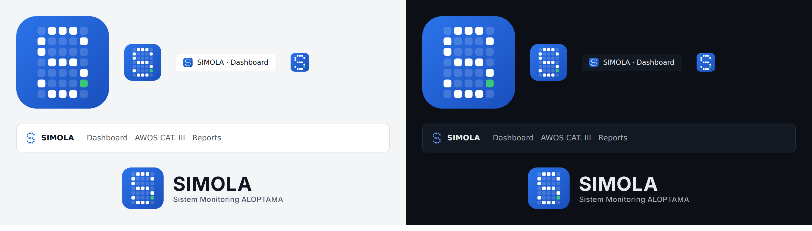

# SIMOLA logo

The letter **S** lit up in a 5 × 7 grid of status cells, the way the dashboard shows availability minute by minute. The green cell is the latest minute: data is coming in.

## Files

| File | Use |
|---|---|
| `simola-mark.svg` | Main icon (blue tile, faint empty cells). Use at 48 px and above |
| `simola-favicon.svg` | Small-size cut: bigger cells, no faint cells. Use at 32 px and below (favicon, browser tab) |
| `simola-mark-mono.svg` | One colour, no tile, cropped to the cells. Uses `currentColor`, so inline it and set the colour (for example the header icon in the accent colour). As an `` it shows black |
| `simola-lockup-light.svg` | Icon with "SIMOLA" and "Sistem Monitoring ALOPTAMA", for light backgrounds |
| `simola-lockup-dark.svg` | The same for dark backgrounds |
| `simola-lockup-compact-light.svg` | Icon with "SIMOLA" only, for light backgrounds. For tight spaces such as a header or a slide footer |
| `simola-lockup-compact-dark.svg` | The same for dark backgrounds |
| `simola-mark-512.png` | Main icon as a 512 px PNG, for places that do not take SVG |

The lettering in the lockups is outlined from Inter (Bold for the name, Medium for the tagline), the app's font, so it looks the same without the font installed.

## Colours

| Part | Value |
|---|---|
| Tile | Gradient `#2b74ea` → `#1a4fbd` (around the app accent `#1f63d6`) |
| Lit cells | `#ffffff` |
| Empty cells | `#ffffff` at 16 % opacity |
| Latest-minute cell | `#3cc777` |
| Name | `#111722` on light, `#e6eaf0` on dark |
| Tagline | `#4c5667` on light, `#a3aebf` on dark |

## Rules

- Keep the S cells as they are: do not move the green cell, recolour the tile or stretch the icon.
- Below 48 px use `simola-favicon.svg`; the faint cells turn to noise at small sizes.
- Leave at least one cell's width of space around the icon and the lockup.
